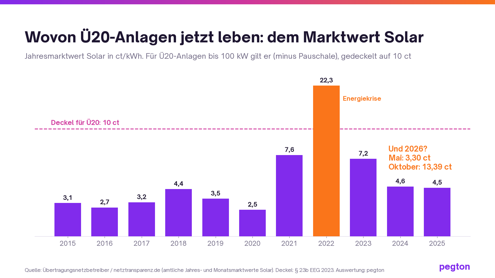

Wer 2006 eine Photovoltaik-Anlage in Betrieb genommen hat, bekommt ab dem 1. Januar 2027 keine feste EEG-Vergütung mehr. Was an ihre Stelle tritt, heißt **Anschlussvergütung**. Die Höhe für 2027 steht noch nicht fest, weil sie vom Jahresmarktwert Solar 2027 abhängt. Fest stehen die Formel, die Pauschale und der Deckel.

## Die Formel

Für ausgeförderte Anlagen **bis 100 kW** gilt (§ 23b, § 53 EEG 2023):

**Anschlussvergütung = Jahresmarktwert Solar, höchstens 10 ct/kWh, minus Vermarktungsabzug.**

Der Abzug für 2027 beträgt **0,601 ct/kWh**. Ihn haben die Übertragungsnetzbetreiber am 26.10.2026 auf netztransparenz.de veröffentlicht. Mit einem intelligenten Messsystem (Smart Meter) halbiert er sich auf 0,3005 ct/kWh.

Die Zahlung läuft automatisch, ohne Antrag, längstens bis zum **31.12.2032** (Solarpaket I). Danach ist die heutige Anschlussregelung nicht mehr vorgesehen.

Anlagen **über 100 kW** haben keinen Anspruch auf diese Vergütung. Für sie bleibt die sonstige Direktvermarktung. Bis Ende 2028 betrifft das 2.272 Anlagen mit zusammen 855 MWp.

## Was der Jahresmarktwert bisher war

Der Jahresmarktwert Solar ist der durchschnittliche Börsenwert von Solarstrom im jeweiligen Kalenderjahr. Die Übertragungsnetzbetreiber veröffentlichen ihn jeweils zu Beginn des Folgejahres. Deshalb kennt niemand die genaue Anschlussvergütung 2027 vor Anfang 2028; Abschläge während des Jahres rechnet der Netzbetreiber später ab.

Bekannte Werte:

| Jahr | Jahresmarktwert Solar | Vermarktungsabzug | ausgezahlt (ohne Smart Meter) |
|---|---|---|---|
| 2024 | 4,624 ct/kWh | 1,808 ct/kWh | 2,816 ct/kWh |
| 2025 | 4,508 ct/kWh | 0,715 ct/kWh | 3,793 ct/kWh |
| 2026 | noch offen (Anfang 2027) | 0,228 ct/kWh | Jahresmarktwert minus 0,228 ct |
| 2027 | noch offen (Anfang 2028) | **0,601 ct/kWh** | Jahresmarktwert minus 0,601 ct, höchstens 9,399 ct |

Die Abzugsbeträge 2024 und 2025 sind die von den Übertragungsnetzbetreibern veröffentlichten Werte; 2025 ergibt 4,508 − 0,715 = 3,793 ct/kWh, gerundet oft „rund 3,8 ct“.

2026 ist bisher ein unruhiges Jahr: Der monatliche Marktwert Solar lag im Mai bei 3,30 ct und im Oktober bei 13,39 ct. Ein einzelner Monat sagt nichts über den Jahreswert. Wer rechnet, sollte mit Spannen rechnen, nicht mit einer Punktprognose.

## Was das in Euro bedeutet

Für die typische private Anlage mit Förderende 2026 (Median **6,84 kWp**, angenommen 6.156 kWh im Jahr) und dem Abzug 2027 ohne Smart Meter:

| Szenario Jahresmarktwert | Vergütung je kWh | Erlös pro Jahr |
|---|---|---|
| 3,0 ct (Niveau 2015–2020) | 2,399 ct | **148 €** |
| 4,508 ct (Niveau 2025, nur als Rechnung) | 3,907 ct | **241 €** |
| 7,5 ct (Niveau 2021/2023) | 6,899 ct | **425 €** |
| 10 ct oder mehr (Deckel) | 9,399 ct | **579 €** |

Der Deckel sitzt auf dem Jahresmarktwert (§ 23b EEG: höchstens 10 ct/kWh). Davon geht der Abzug noch ab. Selbst im besten Fall bleiben 9,399 ct – gegenüber 51,80 ct im Jahr 2006 ein Bruchteil. Bisher (51,80 ct) wären es 3.189 € im Jahr.

Mit Smart Meter fällt der Abzug auf 0,3005 ct. Im 4,508-ct-Szenario stiege die Vergütung auf 4,2075 ct, rund 259 € im Jahr. Der Unterschied ist messbar, aber klein gegen den Hebel Eigenverbrauch.

## Warum Einspeisen allein selten reicht

Eine selbst verbrauchte Kilowattstunde spart den Haushaltsstrompreis. Der lag 2026 laut BDEW im Schnitt bei **37,3 ct/kWh**, für Neukunden zum 1. November bei 40,1 ct. Einspeisen bringt in den obigen Szenarien 2 bis 9 ct. Deshalb steht in den meisten Fällen der [Umbau auf Eigenverbrauch](/ue20-solaranlage-was-tun/) vor einer Diskussion über den Marktwert.

Die Verbraucherzentrale nennt für den Umbau (Umklemmen im Zählerschrank) Kosten ab etwa 200 €, mit neuem Zählerschrank bis etwa 2.000 €.

## Was Sie nicht tun müssen – und was doch

- **Nichts beantragen**, wenn Ihre Anlage höchstens 100 kW hat und weiter volleeinspeist. Die Anschlussvergütung kommt automatisch.
- **Zählerstand am 31.12.** trotzdem dokumentieren, damit die Abrechnung des letzten Förderjahres und des ersten Ü20-Jahres sauber getrennt werden kann.
- **Über 100 kW:** rechtzeitig einen Direktvermarkter suchen. Ohne Vertrag droht, dass der Strom nicht mehr ordnungsgemäß vermarktet wird.
- **Registrierung** im Marktstammdatenregister prüfen.

Die Checkliste und der regionale Blick stehen unter [EEG-Vergütung endet 2026: Was tun?](/eeg-verguetung-endet-2026-was-tun/) und [Post-EEG-Anlagen in meinem Landkreis](/post-eeg-anlagen-landkreis/).

---

**Zum Nachrechnen mit Ihren Zahlen**
- Kostenlos: [Post-EEG-Check](https://pegton.gumroad.com/l/post-eeg-check).
- [Ü20-Kompass](https://pegton.gumroad.com/l/ue20-kompass) (14,90 €) mit Excel-Rechner, in dem sich Marktwert, Abzug und Eigenverbrauch ändern lassen.

*Quellen: EEG 2023 §§ 21, 23b, 53; Übertragungsnetzbetreiber / netztransparenz.de (Jahresmarktwerte Solar, Abzugsbetrag 2026 = 0,228 ct/kWh, Abzugsbetrag 2027 = 0,601 ct/kWh, veröffentlicht 26.10.2026); BDEW-Strompreisanalyse 10/2026; Marktstammdatenregister, Stand 17.11.2026, dl-de/by-2-0, eigene Auswertung. 0,715 ct/kWh ist der Abzug 2025, der mit dem Jahresmarktwert 2025 den ausgezahlten Wert 3,793 ct ergibt. Keine Rechtsberatung und keine Prognose für den Marktwert 2027. Weitere Hinweise: [Methodik](/methodik/).*
