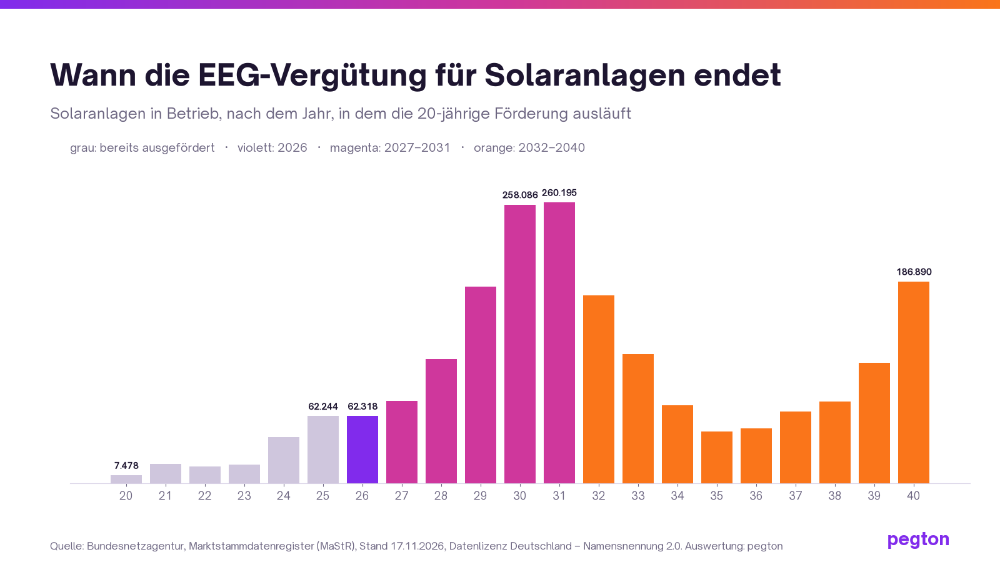

Am 31. Dezember 2026 endet für **62.318 Solaranlagen** in Deutschland die feste EEG-Vergütung. 54.616 davon gehören Privatleuten. Es sind die Anlagen, die 2006 in Betrieb gingen. Wer in diesem Jahr eine Anlage gebaut hat, steht also vor dem Förderende – nicht, weil etwas beantragt werden muss, sondern weil die 20 Jahre plus das Inbetriebnahmejahr ablaufen.

Das ist erst der Anfang der Welle: Ende 2027 folgen 76.351 Anlagen, Ende 2028 schon 114.989. 2030 und 2031 sind es jeweils rund 260.000. Von 2026 bis 2031 zusammen **954.016**. Die Zahlen stammen aus dem Marktstammdatenregister der Bundesnetzagentur (Stand 17.11.2026).

## Müssen Sie bis zum 1. Januar etwas unterschreiben?

Nein. Für Anlagen **bis 100 kW** zahlt der Netzbetreiber ab dem 1. Januar automatisch eine [Anschlussvergütung](/anschlussverguetung-ue20-photovoltaik-2027/). Sie müssen nichts beantragen. Die Regelung gilt bis zum 31.12.2032.

Die Höhe richtet sich nach dem Jahresmarktwert Solar, höchstens 10 ct/kWh, minus einer Vermarktungspauschale. Für 2027 beträgt die Pauschale **0,601 ct/kWh** (halb so viel mit Smart Meter). 2025 kamen nach Abzug rund 3,8 ct/kWh an. Statt 51,80 ct/kWh (typischer Satz für 2006) ist das ein Rückgang um mehr als 90 Prozent.

Anlagen **über 100 kW** bekommen keine Anschlussvergütung. Sie müssen in die sonstige Direktvermarktung. Das betrifft im Jahrgang 2006 378 Anlagen, bis Ende 2028 zusammen 2.272 Anlagen mit 855 MWp.

## Was sich für eine typische private Anlage ändert

Der Median der privaten Anlagen mit Förderende 2026 liegt bei **6,84 kWp**. Bei angenommenen 900 kWh je kWp sind das 6.156 kWh im Jahr:

| | pro Jahr |
|---|---|
| bisher (51,80 ct) | **3.189 €** |
| ab 2027, alles einspeisen (Szenario 3,91 ct) | **241 €** |
| Umbau auf Eigenverbrauch (30 % selbst genutzt) | **857 €** |
| Eigenverbrauch mit Speicher (60 %) | **1.474 €** |

„Wert“ heißt: eingesparte Stromkosten (BDEW-Haushaltspreis 2026: 37,3 ct/kWh) plus Vergütung für den Rest, ohne Investitionskosten. 97,9 % dieser privaten Anlagen speisen heute noch alles ein. Eine selbst genutzte Kilowattstunde ist deshalb fast zehnmal so viel wert wie eine eingespeiste. Die ausführliche Rechnung steht im Artikel [Ü20-Solaranlage: Was am 1. Januar 2027 wirklich passiert](/ue20-solaranlage-was-tun/).

## Die kurze To-do-Liste

1. **Förderende prüfen.** Inbetriebnahmejahr + 20, Ende jeweils am 31.12. Das steht in der Jahresabrechnung.
2. **Registrierung prüfen.** Fehlt die Anlage im Marktstammdatenregister, nachmelden.
3. **Zählerstand am 31.12.** ablesen und fotografieren.
4. **Technik prüfen lassen**, bevor Sie investieren: 20 Jahre alte Kabel, Stecker, Wechselrichter und Zählerschränke.
5. **Drei vergleichbare Angebote** einholen. Nichts beim ersten Termin unterschreiben. Haustürverträge können Sie in der Regel 14 Tage widerrufen.
6. **Wenn Sie umbauen, dann vor dem Sommer.** Der größte Ertrag fällt in den Sommermonaten an.
7. **Smart Meter:** 48,9 % der privaten Anlagen dieses Jahrgangs haben mehr als 7 kW und sind damit Pflichteinbaufall (§ 29 Messstellenbetriebsgesetz). Der Messstellenbetreiber rüstet bis 2032 nach; die Pauschale auf die Anschlussvergütung halbiert sich dann.

## Wo stehen die Anlagen?

Die erste Welle liegt vor allem im Süden: Bayern und Baden-Württemberg stellen 53,3 % der Anlagen mit Förderende 2026 bis 2028. Welche Landkreise am stärksten betroffen sind – sauber getrennt nach Stadt und Landkreis – steht in [Post-EEG-Anlagen in meinem Landkreis](/post-eeg-anlagen-landkreis/).

---

**Zum Weiterlesen und Nachrechnen**
- Kostenlos: [Post-EEG-Check](https://pegton.gumroad.com/l/post-eeg-check), die 10-Punkte-Checkliste als PDF.
- [Ü20-Kompass](https://pegton.gumroad.com/l/ue20-kompass) (14,90 €): 12-seitiger Ratgeber, Excel-Rechner mit Ihren eigenen Zahlen, sechs Musterbriefe und die Zahlen für Ihren Landkreis.

*Quellen und Annahmen: siehe [Methodik und Quellen](/methodik/). Keine Rechts- oder Steuerberatung.*
