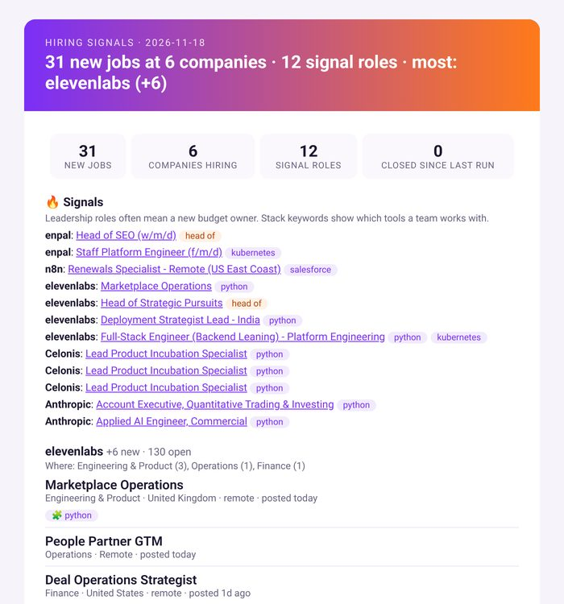
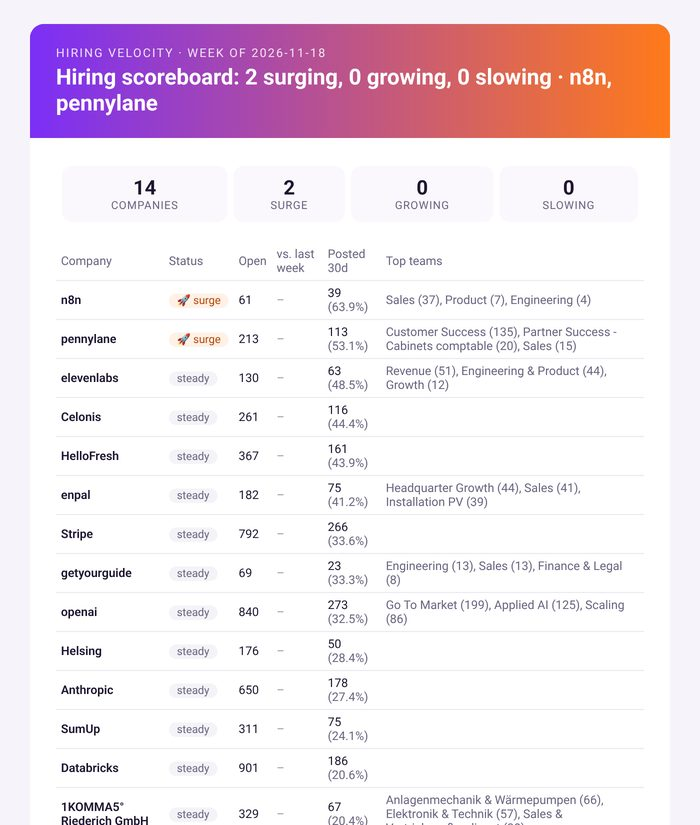

A job posting is a public note about what a company is about to spend money on. Five open data-engineering roles mean a growing data team, and probably new tools. A new "Head of Security" is a new budget owner who will pick vendors in the next few months. A team whose open roles drop by a third has probably filled its hiring wave or stopped hiring.

Sales teams, recruiters and investors all watch for this. You don't need a paid intent-data tool for it, because most companies publish their jobs through an applicant tracking system (ATS) with a public, read-only feed.

## Which job boards companies actually use

On 18 November 2026 we checked the job boards of 99 well-known tech, fintech, consumer and energy companies. Together they had **21,047 open jobs**. The ATS split:

| ATS | Boards | Public feed |
|---|---:|---|
| Greenhouse | 52 | `boards-api.greenhouse.io/v1/boards/{slug}/jobs` |
| Ashby | 34 | `api.ashbyhq.com/posting-api/job-board/{slug}` |
| Lever | 5 | `api.lever.co/v0/postings/{slug}?mode=json` |
| SmartRecruiters | 4 | `api.smartrecruiters.com/v1/companies/{slug}/postings` |
| Personio | 2 | `{slug}.jobs.personio.de/xml` |
| Workable, Recruitee | 1 each | `apply.workable.com/api/v1/widget/accounts/{slug}`, `{slug}.recruitee.com/api/offers/` |

Greenhouse and Ashby cover 86 of the 99. In German-speaking countries, many mid-sized companies use **Personio**, which many job-alert templates don't cover.

None of these endpoints needs an API key, and none exposes candidate data. They return exactly what the company shows on its careers page.

## How "only new jobs" works

The fetch is easy. The harder part is remembering what you have already seen:

1. Fetch every board once and store all job IDs (per board). That is your **baseline**. Don't send it as "new".
2. On every later run, report only IDs that aren't in the stored list, then save the new list.
3. IDs that disappeared are **closed** jobs. Count them, because that's a signal too.
4. Key the IDs by `ats + board + jobId`. Two companies on different ATS can have the same numeric ID.

If you build this yourself in n8n, the *Remove Duplicates* node ("remove items processed in previous executions") handles step 2, but it can't tell you about closed jobs or baselines. A small key-value store per board can.

## What to treat as a signal

Raw "new job" lists get noisy fast. Three filters make them useful:

- **Signal roles:** titles with *Head of, VP, Director, Chief, Founding* (or *Leiter/Leitung* in German). These are new decision-makers.
- **Stack keywords in the description:** search the job text for tools you sell or compete with, e.g. *Salesforce, Snowflake, SAP*. A data-engineer job that mentions Snowflake tells you what that team runs.
- **Velocity, not volume:** a company with 800 open jobs isn't necessarily growing. Compare how many roles were posted in the last 30 days with how many are open.

## What "normal" hiring velocity looks like

Among the 86 boards in our sample with at least 20 open jobs, the **median company had posted 39 % of its open roles in the last 30 days** (18 Nov 2026). The fastest were Parloa (80 %), Dropbox (78 %), Webflow (72 %), Qonto (70 %) and Contentful (67 %). The slowest included Palantir (8 %), Agicap (12 %) and Thermondo (18 %).

So "30 % of roles are fresh" is normal churn. Something above 50 % is a real hiring push, about the top quarter of this sample. Week-over-week changes in the open-role count (±15 %) show when a company speeds up or slows down.

These are snapshots from one day. Postings are re-published, merged or kept open as evergreen roles, so treat the numbers as a direction, not as exact headcount.

## The ready-made version

If you don't want to build this yourself, **[Hiring Signals for n8n](https://pegton.gumroad.com/l/hiring-signals-n8n)** ($24) is two tested workflows:

- a **daily digest** with only the new jobs per company, signal roles on top, stack keywords and closed-job counts
- a **weekly scoreboard** with open roles, roles posted in 30 days, change vs. last week and a status (*surge, growing, slowing*)

It also includes the 99 job-board URLs from this article as a CSV. It works with Greenhouse, Lever, Ashby, Workable, SmartRecruiters, Recruitee and Personio through the [ATS Jobs Scraper](https://apify.com/pegton/ats-jobs-scraper) on Apify ($0.001 per new job).

**A note on outreach:** job postings are company data, but the people you contact afterwards are not. In the EU, follow GDPR, and check your country's rules on unsolicited e-mail before you act on a signal (in Germany, §7 UWG).

*Data: public job boards of 99 companies, checked 18 Nov 2026 with pegton/ats-jobs-scraper.*
