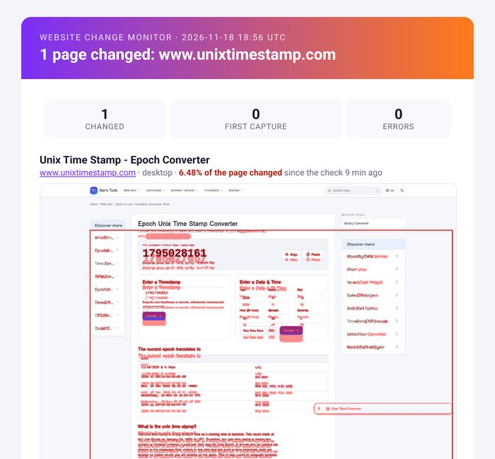

Visual change monitoring sounds simple: take a screenshot, compare it with the last one, alert if they differ. Most n8n templates for this use a paid screenshot API and a fixed threshold such as "alert if more than 1 % of pixels changed".

We tested how well that works on real pages.

## How much pages change on their own

On 18 November 2026 we took two full-page desktop screenshots of six pages, **two minutes apart**, with nothing changing on purpose:

| Page | Changed pixels |
|---|---:|
| example.com | 0 % |
| zapier.com/pricing | 0.26 % |
| notion.com/pricing | 5.06 % |
| n8n.io/pricing | 9.68 % |
| spiegel.de | 10.66 % |
| bbc.com/news | 15.94 % |

With a 1 % threshold, four of six pages would alert on **every check**. A stripe.com/pricing capture failed in the same test, so be ready for some pages to block screenshots.

The causes are mundane: carousels and animations, rotating headlines, counters, cookie layers, and above all **layout shifts**. If a banner above the fold is a few pixels taller, every pixel below it moves and the whole page counts as changed.

## Three ways to get only real changes

1. **Watch one element, not the page.** If you care about prices, capture only the pricing table with a CSS selector (`#pricing`, `.pricing-table`). This is the most precise fix.
2. **Hide the noise.** Hide carousels, chat widgets and banners with CSS before the screenshot is taken. Hiding a cookie banner with CSS is not the same as accepting it, and it changes nothing on the site.
3. **Learn each page's normal noise.** Keep the last few change values per page. Once you have three, alert only when a change is clearly higher than usual, for example more than 1.5× the median and at least 2 points above it. A news homepage then stops alerting every hour, but a redesign still gets through.

## A free n8n template that does all three

The **[Website Change Monitor](https://pegton.gumroad.com/l/website-change-monitor-n8n)** template is free (pay what you want). Every 12 hours it:

- captures each URL in a real browser on desktop, laptop, tablet or mobile
- compares the screenshot with the last one, with the changes outlined in red
- learns each page's usual noise (`suppressNoise`) and supports `elementSelector` and `hideSelectors`
- sends an e-mail or Slack message only when something really changed, and the first run confirms which pages are being watched

Screenshots come from the [Website Screenshot & Visual Change Monitor](https://apify.com/pegton/website-screenshot-monitor) Actor on Apify: $0.002 per changed page. Unchanged pages are not charged, so Apify's free monthly credit covers a lot of pages.

**Good things to watch:** competitors' pricing and plan pages, terms of service and privacy policies (a timestamped screenshot is useful evidence), affiliate programme terms, your own site on mobile after each deploy, and landing pages of competitors' ad campaigns.

*Measurements: pegton/website-screenshot-monitor, 18 Nov 2026, desktop 1920 px, full page, two captures 2 minutes apart.*

**Open source:** the workflow JSON is on GitHub at [Zapparelo/n8n-website-change-monitor](https://github.com/Zapparelo/n8n-website-change-monitor) (MIT), and the shift-tolerant diff algorithm is a standalone Python package: [Zapparelo/shiftdiff](https://github.com/Zapparelo/shiftdiff) (`pip install git+https://github.com/Zapparelo/shiftdiff`).
