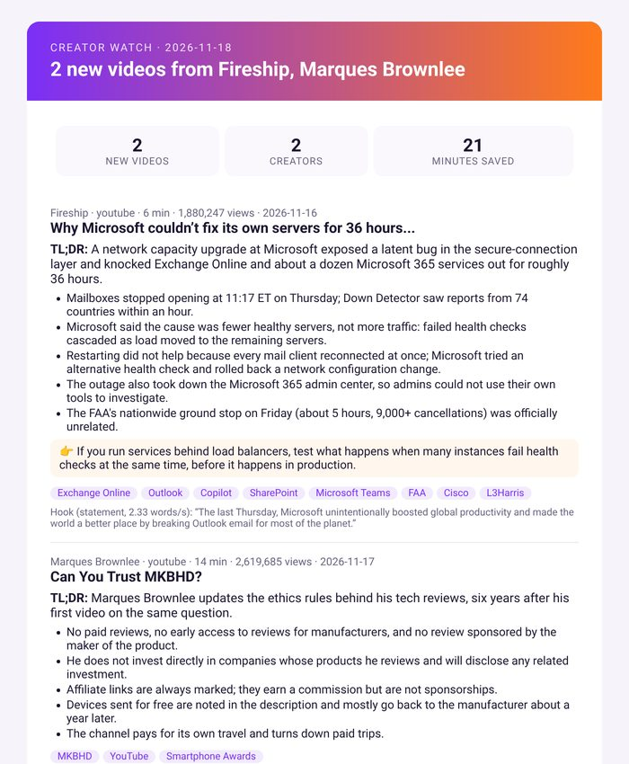

If you follow a dozen YouTube channels for work, you are always behind. The fix is not watching faster. It is reading a summary and only watching the videos that matter.

Here's how a daily "creator digest" works in n8n, and what to watch out for.

## The pipeline

1. **List the new videos** of each channel or profile since the last run.
2. **Get the transcript.** Use the existing captions where they exist (fast and cheap). Fall back to speech-to-text where they don't, which applies to many TikToks.
3. **Summarise** each transcript with an LLM: one-sentence TL;DR, 3–6 key points, the products and companies mentioned, and one actionable takeaway.
4. **Send one e-mail** with all new videos, and remember which video IDs you have already sent.

## Pitfalls we ran into

- **Shorts vs. long-form.** A YouTube channel has separate tabs. If you only ask for "videos", you miss channels that mainly post Shorts, and the reverse is also true. Decide per use case.
- **No speech.** Some videos are music only. In our test, a NASA TikTok came back as "no speech detected". The workflow should skip these quietly, and not pay for them.
- **Duplicates.** "Videos from the last 2 days" on a daily schedule overlaps by design, so you don't miss anything at the edges. That only works if you also store the IDs you have already sent.
- **Long transcripts.** A 1-hour podcast is 10,000+ words. Cut the input (we use 24,000 characters, about 6,000 tokens). Small models summarise that well for a fraction of a cent.
- **JSON from LLMs.** Ask for a JSON object, but parse defensively: strip code fences and fall back to the opening sentences if parsing fails. Then the digest still goes out.

## What it costs

With the [video transcripts Actor](https://apify.com/pegton/video-transcripts) on Apify, a video with captions costs $0.01. Speech-to-text costs $0.01 per started 2 minutes of audio, and failed or private videos are free. Ten channels with about 15 new videos a week come to about **$0.65 a month**, plus a few cents for a small model such as gpt-4o-mini. With a local Ollama model, the AI step costs nothing.

## Ready-made: Creator Watch for n8n

**[Creator Watch](https://pegton.gumroad.com/l/creator-watch-n8n)** ($19) is this pipeline as one tested n8n workflow:

- YouTube channels (videos, Shorts or both) and TikTok profiles
- works with any **OpenAI-compatible** API (OpenAI, OpenRouter, Groq, Mistral, Ollama), or with no AI at all
- summaries in your language and with your focus, plus each video's opening hook
- no duplicates, and no e-mail on days without new videos. Optional Google Sheets log

*The example shows two real videos from 16 and 17 Nov 2026. AI summaries can contain mistakes, so check important facts in the video.*
