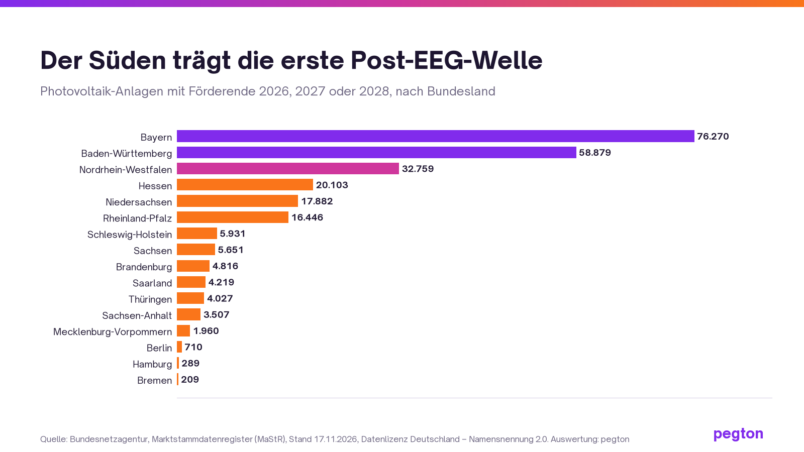
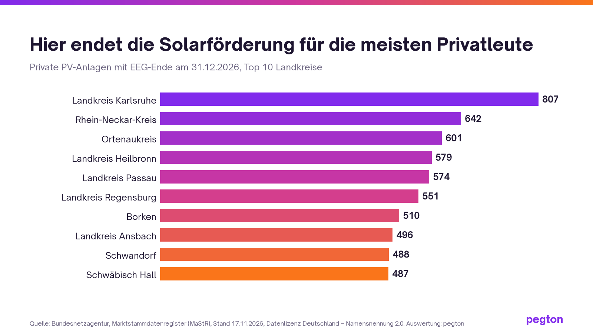
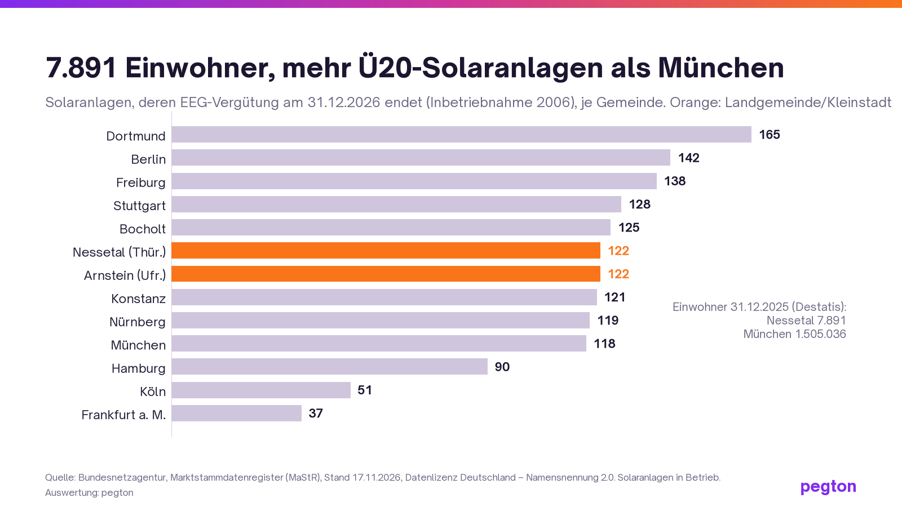
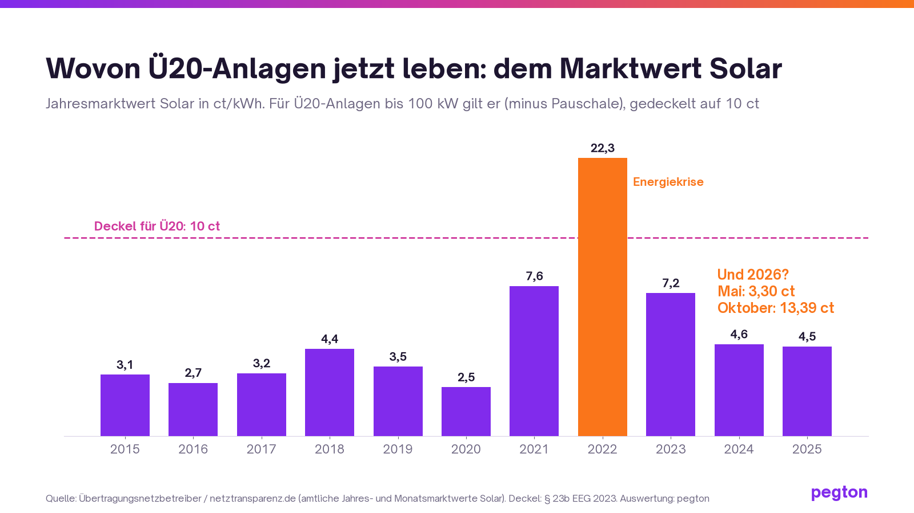
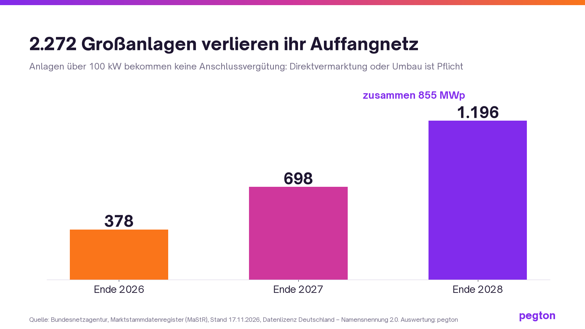

Die erste große Welle der deutschen Solarförderung läuft aus. Am 31. Dezember 2026 endet die 20-jährige EEG-Vergütung für **62.318 Photovoltaik-Anlagen**, die 2006 in Betrieb gingen. Ende 2027 folgen 76.351, Ende 2028 schon 114.989. Und das ist erst der Anfang: 2030 und 2031 fallen jeweils rund **260.000 Anlagen** aus der Förderung, mehr als viermal so viele wie 2026. Von 2026 bis 2031 sind es zusammen **954.016**.

Die öffentlichen Daten des Marktstammdatenregisters (MaStR) der Bundesnetzagentur (Stand 17.11.2026, alle Solaranlagen in Betrieb) zeigen, wo diese Anlagen stehen. Die ausführlichen Tabellen aller Bundesländer und der Top-Kreise stehen unter [Post-EEG-Anlagen in meinem Landkreis](/post-eeg-anlagen-landkreis/).

## Bundesländer: Der Süden trägt die Welle

Bayern und Baden-Württemberg stellen zusammen **53,3 %** aller Anlagen, deren Förderung 2026 bis 2028 endet:

| Bundesland | Förderende 2026–2028 |
|---|---|
| Bayern | 76.270 |
| Baden-Württemberg | 58.879 |
| Nordrhein-Westfalen | 32.759 |
| Hessen | 20.103 |
| Niedersachsen | 17.882 |
| Rheinland-Pfalz | 16.446 |

Die fünf ostdeutschen Flächenländer kommen zusammen auf nur **7,9 %**. Das spiegelt, wo die Solarbranche 2006 bis 2008 ihre Kunden fand: auf Einfamilienhäusern und Bauernhöfen im Süden.

## Landkreise: Karlsruhe, Rhein-Neckar, Ortenau

Bei den privaten Anlagen mit Förderende 2026 liegt der **Landkreis Karlsruhe** mit 807 vorn, vor dem Rhein-Neckar-Kreis (642) und dem Ortenaukreis (601). Über alle Betreiber und die Jahrgänge 2026 bis 2028 hinweg führt **Schwäbisch Hall** (2.868) knapp vor den Landkreisen Karlsruhe (2.762) und Heilbronn (2.696).

*Ein Hinweis für alle, die selbst mit MaStR-Daten arbeiten:* Das Feld „Landkreis“ verwendet für eine kreisfreie Stadt und den gleichnamigen Landkreis denselben Namen, zum Beispiel bei Karlsruhe, München, Regensburg, Heilbronn oder Passau (22 solcher Paare). Wer nach Namen gruppiert, addiert Stadt und Land unbemerkt zusammen. Sauber trennt man über die ersten fünf Stellen des Gemeindeschlüssels. Genau so sind die Zahlen hier und in der [Landkreis-Tabelle](/post-eeg-anlagen-landkreis/) gerechnet.

## Gemeinden: Ein Dorf in Thüringen schlägt München

Nach Gemeinden führen erwartungsgemäß Großstädte: Dortmund (165), Berlin (142), Freiburg (138), Stuttgart (128). Doch auf den Plätzen 6 und 7 stehen zwei Orte, die man dort nicht erwartet: **Arnstein** in Unterfranken (Landkreis Main-Spessart) und **Nessetal** im Landkreis Gotha, mit je 122 Anlagen. Nessetal hat rund 7.900 Einwohner, München 1,5 Millionen und 118 Anlagen. 52 der 122 Anlagen in Nessetal stehen laut Register auf landwirtschaftlichen Gebäuden. Das sieht nach Landwirten aus, die 2006 sehr früh aufs Dach gegangen sind. (Ein zweites Arnstein in Sachsen-Anhalt ist nicht mitgezählt.)

## Was den Betreibern jetzt bevorsteht

Fast alle Anlagen dieses Jahrgangs speisen ihren Strom komplett ein (97,8 %). Ab Januar bekommen sie statt bis zu 51,80 ct/kWh nur noch den Marktwert Solar minus eine Pauschale. Das waren 2025 3,793 ct/kWh, und der Wert schwankt stark:

Anlagen bis 100 kW bekommen diese [Anschlussvergütung](/anschlussverguetung-ue20-photovoltaik-2027/) automatisch bis 2032. Für Anlagen **über 100 kW** gibt es kein solches Auffangnetz: Bis Ende 2028 sind das **2.272 Anlagen mit zusammen 855 MWp**. Sie brauchen einen Direktvermarkter oder ein neues Konzept mit Eigenverbrauch.

Für Hausbesitzer ist meist der [Umbau auf Eigenverbrauch](/ue20-solaranlage-was-tun/) der wichtigste Schritt: Eine selbst genutzte Kilowattstunde spart rund 37 ct Strompreis, eine eingespeiste bringt rund 4 ct.

## Warum das für Handwerk und Energiewirtschaft relevant ist

Jede dieser Anlagen ist ein Anlass: für Eigenverbrauchs-Umbauten, Speicher, Wechselrichtertausch, Repowering oder einen Direktvermarktungsvertrag. Die regionale Verteilung zeigt, wo Elektro- und Solarbetriebe in den nächsten Jahren am meisten zu tun haben werden. Weil die Welle bis 2031 noch auf das Vierfache wächst, lohnt sich der Blick über 2026 hinaus.

---

**Daten und Werkzeuge**
- Für Betreiber: [Post-EEG-Check](https://pegton.gumroad.com/l/post-eeg-check) (gratis) und [Ü20-Kompass](https://pegton.gumroad.com/l/ue20-kompass) (Ratgeber mit Rechner).
- Für Solarteure und Energieberater: [Ü20-Solar-Atlas](https://pegton.gumroad.com/l/ue20-solar-atlas) mit allen 417.003 Anlagen nach PLZ und Gemeinde, aggregiert.
- Für Direktvermarkter: [Post-EEG Gewerbe-Liste](https://pegton.gumroad.com/l/post-eeg-gewerbe-liste) mit 4.858 Firmen- und Kommunalanlagen ab 30 kWp von 2.672 Organisationen (keine Privatpersonen, keine Kontaktdaten).
- Selbst abfragen: Der Apify-Actor [pegton/mastr-energy-units](https://apify.com/pegton/mastr-energy-units) liefert MaStR-Einheiten als Tabelle.

*Quelle: Bundesnetzagentur, Marktstammdatenregister, www.marktstammdatenregister.de, Stand 17.11.2026, Datenlizenz Deutschland – Namensnennung – Version 2.0 (www.govdata.de/dl-de/by-2-0); eigene Auswertung, aggregiert. Förderende = Inbetriebnahmejahr + 20, jeweils 31.12.; ob eine Anlage tatsächlich EEG-Vergütung bezieht, ist im Register nicht erkennbar. Einwohner: Destatis, 31.12.2025. Marktwerte: netztransparenz.de. Methodik: [Methodik und Quellen](/methodik/).*
