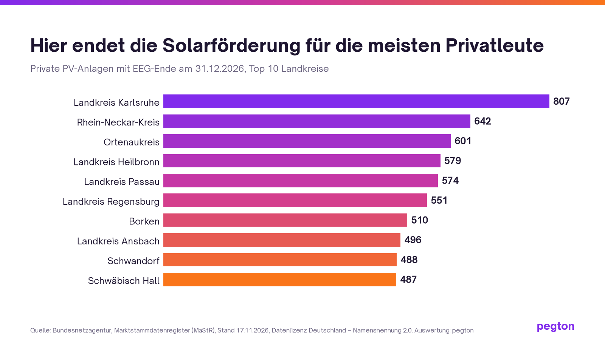
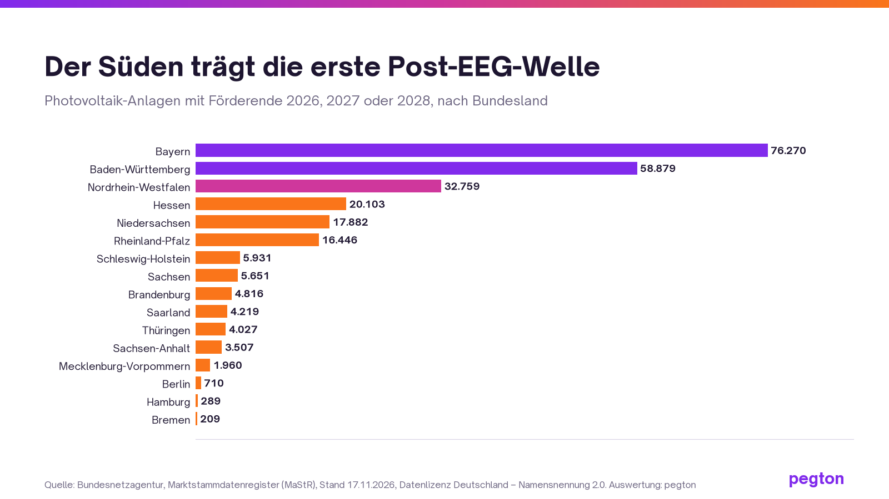

Wer wissen will, wie stark das eigene Umfeld von der auslaufenden EEG-Vergütung betroffen ist, braucht eine saubere Kreisauswertung. Das Marktstammdatenregister nennt Stadt und Landkreis oft gleich, zum Beispiel Karlsruhe oder Passau. Diese Seite trennt beide über die ersten fünf Stellen des Amtlichen Gemeindeschlüssels. Ohne diesen Schritt würden 22 Stadt-Land-Paare zusammengezählt.

Datenstand ist der 17.11.2026, alle Solaranlagen mit Status „In Betrieb“. Förderende heißt: Inbetriebnahmejahr plus 20, jeweils zum 31. Dezember. Ob eine Anlage tatsächlich EEG-Vergütung bezieht, steht im Register nicht.

## Private Anlagen mit Förderende am 31.12.2026

54.616 private Anlagen fallen an diesem Stichtag aus der festen Vergütung. Die zehn Landkreise mit den meisten privaten Anlagen:

Die ersten zwanzig, ebenfalls nur privat, nur Jahrgang 2026:

| Rang | Kreis | Land | Anlagen |
|---|---|---|---|
| 1 | Landkreis Karlsruhe | Baden-Württemberg | 807 |
| 2 | Rhein-Neckar-Kreis | Baden-Württemberg | 642 |
| 3 | Ortenaukreis | Baden-Württemberg | 601 |
| 4 | Landkreis Heilbronn | Baden-Württemberg | 579 |
| 5 | Landkreis Passau | Bayern | 574 |
| 6 | Landkreis Regensburg | Bayern | 551 |
| 7 | Borken | Nordrhein-Westfalen | 510 |
| 8 | Landkreis Ansbach | Bayern | 496 |
| 9 | Schwandorf | Bayern | 488 |
| 10 | Schwäbisch Hall | Baden-Württemberg | 487 |
| 11 | Ravensburg | Baden-Württemberg | 476 |
| 12 | Steinfurt | Nordrhein-Westfalen | 466 |
| 13 | Biberach | Baden-Württemberg | 461 |
| 14 | Emsland | Niedersachsen | 459 |
| 15 | Gütersloh | Nordrhein-Westfalen | 437 |
| 16 | Ostalbkreis | Baden-Württemberg | 425 |
| 17 | Ostallgäu | Bayern | 423 |
| 18 | Esslingen | Baden-Württemberg | 419 |
| 19 | Alb-Donau-Kreis | Baden-Württemberg | 418 |
| 20 | Rottal-Inn | Bayern | 411 |

Zum Vergleich die kreisfreien Städte neben den gleichnamigen Landkreisen (ebenfalls privat, 2026): Karlsruhe (Stadt) 62, Heilbronn (Stadt) 54, Passau (Stadt) 57, Regensburg (Stadt) 97, München (Stadt) 75, Landkreis München 116. Wer Stadt und Landkreis Karlsruhe zusammenzöge, käme auf 869 und würde den Landkreis falsch ausweisen.

## Alle Betreiber, Förderende 2026 bis 2028

Zählt man private und gewerbliche Anlagen und die drei Jahrgänge 2026, 2027 und 2028 zusammen, verschiebt sich die Reihenfolge. Dann führt Schwäbisch Hall, weil 2027 und 2028 dort deutlich stärker ausfallen als 2026:

| Rang | Kreis | Land | 2026 | 2027 | 2028 | Summe |
|---|---|---|---|---|---|---|
| 1 | Schwäbisch Hall | Baden-Württemberg | 554 | 943 | 1.371 | 2.868 |
| 2 | Landkreis Karlsruhe | Baden-Württemberg | 900 | 840 | 1.022 | 2.762 |
| 3 | Landkreis Heilbronn | Baden-Württemberg | 672 | 810 | 1.214 | 2.696 |
| 4 | Biberach | Baden-Württemberg | 511 | 770 | 1.306 | 2.587 |
| 5 | Rottal-Inn | Bayern | 447 | 718 | 1.358 | 2.523 |
| 6 | Rhein-Neckar-Kreis | Baden-Württemberg | 718 | 855 | 942 | 2.515 |
| 7 | Ortenaukreis | Baden-Württemberg | 701 | 742 | 1.067 | 2.510 |
| 8 | Ravensburg | Baden-Württemberg | 534 | 775 | 1.134 | 2.443 |
| 9 | Landkreis Passau | Bayern | 616 | 654 | 1.136 | 2.406 |
| 10 | Alb-Donau-Kreis | Baden-Württemberg | 471 | 772 | 1.161 | 2.404 |
| 11 | Dingolfing-Landau | Bayern | 354 | 726 | 1.289 | 2.369 |
| 12 | Landkreis Ansbach | Bayern | 552 | 640 | 1.169 | 2.361 |
| 13 | Borken | Nordrhein-Westfalen | 565 | 717 | 1.013 | 2.295 |
| 14 | Ostalbkreis | Baden-Württemberg | 478 | 668 | 1.065 | 2.211 |
| 15 | Steinfurt | Nordrhein-Westfalen | 516 | 674 | 985 | 2.175 |

Zusammen sind das 253.658 Anlagen in 400 Kreisen bzw. kreisfreien Städten. Die übrigen 385 Kreise stehen nicht in dieser Kurzliste; typische Werte liegen klar unter den Zahlen oben.

## Alle 16 Bundesländer

| Bundesland | 2026 | 2027 | 2028 | 2026–2028 |
|---|---|---|---|---|
| Bayern | 18.212 | 22.242 | 35.816 | 76.270 |
| Baden-Württemberg | 14.645 | 18.162 | 26.072 | 58.879 |
| Nordrhein-Westfalen | 7.858 | 9.972 | 14.929 | 32.759 |
| Hessen | 5.213 | 6.397 | 8.493 | 20.103 |
| Niedersachsen | 5.075 | 5.364 | 7.443 | 17.882 |
| Rheinland-Pfalz | 4.370 | 4.927 | 7.149 | 16.446 |
| Schleswig-Holstein | 1.451 | 1.832 | 2.648 | 5.931 |
| Sachsen | 1.221 | 1.660 | 2.770 | 5.651 |
| Brandenburg | 939 | 1.550 | 2.327 | 4.816 |
| Saarland | 678 | 1.035 | 2.506 | 4.219 |
| Thüringen | 985 | 1.198 | 1.844 | 4.027 |
| Sachsen-Anhalt | 899 | 1.038 | 1.570 | 3.507 |
| Mecklenburg-Vorpommern | 468 | 601 | 891 | 1.960 |
| Berlin | 142 | 223 | 345 | 710 |
| Hamburg | 90 | 88 | 111 | 289 |
| Bremen | 72 | 62 | 75 | 209 |
| **Deutschland** | **62.318** | **76.351** | **114.989** | **253.658** |

Bayern und Baden-Württemberg stellen zusammen 53,3 % dieser Welle, die fünf ostdeutschen Flächenländer 7,9 %. Gemeinden können das Bild noch einmal verschieben: Nessetal im Landkreis Gotha hat 122 Anlagen mit Förderende 2026, ebenso viele wie Arnstein in Unterfranken – und mehr als München (118). Der Hintergrund dazu steht im Artikel [Post-EEG 2026: Wo in Deutschland die meisten Solaranlagen aus der Förderung fallen](/post-eeg-2026-landkreise/).

## Was die Zahlen für Betreiber heißen

Fast alle Anlagen dieser Jahrgänge speisen noch voll ein (2026: 97,8 %). Ab dem Förderende gilt die [Anschlussvergütung](/anschlussverguetung-ue20-photovoltaik-2027/) nur bis 100 kW und liegt typischerweise im niedrigen einstelligen Cent-Bereich. Für Haushalte ist der wichtigste Hebel meist der [Umbau auf Eigenverbrauch](/ue20-solaranlage-was-tun/).

Für Handwerk, Speichervertrieb und Direktvermarkter zeigt die regionale Verteilung, wo 2027 und 2028 die Arbeit liegt – und dass 2030/2031 die Kohorten noch einmal auf rund 260.000 Anlagen pro Jahr wachsen.

---

**Daten für alle 400 Kreise und 8.054 Postleitzahlen**
- Für Betreiber: [Post-EEG-Check](https://pegton.gumroad.com/l/post-eeg-check) (gratis) und [Ü20-Kompass](https://pegton.gumroad.com/l/ue20-kompass) (Ratgeber mit Rechner und Kreiszahlen).
- Für Solarteure und Energieberater: [Ü20-Solar-Atlas](https://pegton.gumroad.com/l/ue20-solar-atlas) mit allen 417.003 Anlagen nach PLZ, Gemeinde und Landkreis (Kreise über AGS getrennt).
- Für Direktvermarkter: [Post-EEG Gewerbe-Liste](https://pegton.gumroad.com/l/post-eeg-gewerbe-liste) mit 4.858 Firmen- und Kommunalanlagen ab 30 kWp, von 2.672 Organisationen (keine Privatpersonen, keine Kontaktdaten).

*Quelle: Bundesnetzagentur, Marktstammdatenregister, Stand 17.11.2026, Datenlizenz Deutschland – Namensnennung 2.0; eigene Auswertung, aggregiert. Methodik der Kreisabgrenzung: [Methodik und Quellen](/methodik/).*
