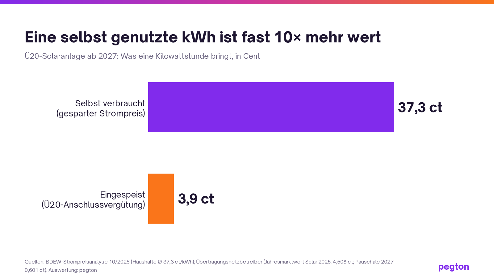
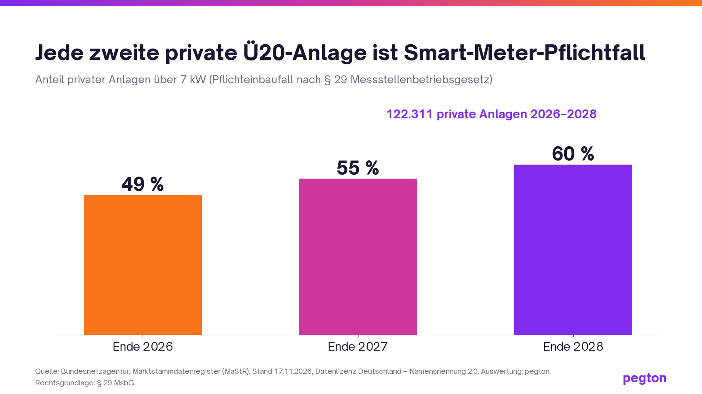

Am 31. Dezember 2026 endet für **62.318 Solaranlagen** in Deutschland die feste EEG-Vergütung. 54.616 davon gehören Privatleuten. Das zeigt eine Auswertung des Marktstammdatenregisters der Bundesnetzagentur (Stand 17.11.2026). Es sind die Anlagen, die im Jahr 2006 ans Netz gingen, damals mit einer garantierten Vergütung von 51,80 Cent pro Kilowattstunde für 20 Jahre plus das Inbetriebnahmejahr.

Wer jetzt Post von Solarfirmen bekommt oder an der Haustür angesprochen wird, hört oft: „Sie müssen jetzt handeln.“ Das stimmt nur halb. Hier ist, was wirklich passiert. Eine kürzere Checkliste steht unter [EEG-Vergütung endet 2026: Was tun?](/eeg-verguetung-endet-2026-was-tun/).

## 1. Die Anlage darf weiterlaufen, automatisch

Für Anlagen **bis 100 kW** zahlt der Netzbetreiber ab dem 1. Januar automatisch eine **[Anschlussvergütung](/anschlussverguetung-ue20-photovoltaik-2027/)**. Sie müssen dafür nichts beantragen und nichts unterschreiben. Die Regel gilt seit dem Solarpaket I bis zum **31.12.2032**.

Die Höhe: der **Jahresmarktwert Solar** (der durchschnittliche Börsenwert von Solarstrom im jeweiligen Jahr), höchstens 10 ct/kWh, minus einer Pauschale für die Vermarktungskosten. Die Pauschale beträgt für 2027 **0,601 ct/kWh** und halbiert sich mit einem Smart Meter.

Anlagen **über 100 kW** sind die Ausnahme: Für sie gibt es keine Anschlussvergütung. Sie müssen in die Direktvermarktung. Das betrifft bis Ende 2028 2.272 Anlagen.

## 2. Was „Marktwert“ in Euro bedeutet

Der Jahresmarktwert Solar lag 2025 bei 4,508 ct/kWh, 2024 bei 4,624 ct, 2020 bei nur 2,458 ct. Ü20-Anlagen bekamen 2025 nach Abzug 3,793 ct/kWh.

Für eine typische private Anlage aus 2006 heißt das: Sie hat **6,84 kWp** (Median im Register) und erzeugt bei angenommenen 900 kWh pro kWp rund **6.156 kWh** im Jahr.

| | pro Jahr |
|---|---|
| bisher (51,80 ct) | **3.189 €** |
| ab 2027, alles einspeisen (3,91 ct) | **241 €** |

Ein Rückgang um 92 %. Und 97,9 % dieser privaten Anlagen speisen heute noch alles ein.

2026 ist allerdings ein Sonderjahr: Der monatliche Marktwert Solar lag im Mai bei 3,30 ct, im Oktober bei 13,39 ct (gestiegene Gaspreise). Wie hoch er 2027 liegt, kann niemand seriös sagen. Wer rechnet, sollte deshalb mit Spannen rechnen: Selbst beim Deckel (Jahresmarktwert 10 ct minus Pauschale 0,601 ct = 9,399 ct) kämen rund 579 € im Jahr an.

## 3. Der eigentliche Hebel: selbst verbrauchen

Jede Kilowattstunde, die Sie selbst verbrauchen, müssen Sie nicht kaufen. Der durchschnittliche Haushaltsstrompreis liegt 2026 laut BDEW bei **37,3 ct/kWh**, für Neukunden zum 1. November sogar bei 40,1 ct. Einspeisen bringt rund 4 ct. **Selbst verbrauchen ist fast zehnmal so viel wert.**

Für die Beispielanlage:

| Option | Wert pro Jahr |
|---|---|
| A: nichts ändern (Volleinspeisung) | 241 € |
| B: Umbau auf Eigenverbrauch (30 % selbst genutzt) | 857 € |
| C: Eigenverbrauch mit Speicher (60 %) | 1.474 € |

„Wert“ heißt: eingesparte Stromkosten plus Vergütung für den Rest, ohne Investitionskosten.

Der Umbau auf Eigenverbrauch (ein Elektrobetrieb klemmt die Anlage im Zählerschrank um) kostet laut Verbraucherzentrale **ab etwa 200 €**, mit neuem Zählerschrank bis etwa **2.000 €**. Bei 616 € Mehrwert pro Jahr ist das nach wenigen Monaten bis gut drei Jahren wieder drin.

Beim Speicher entscheidet der Preis. Er bringt in diesem Beispiel rund 617 € pro Jahr mehr als Option B. Teilen Sie den Angebotspreis durch Ihren Mehrwert: Kommt mehr als zehn Jahre heraus, lohnt sich Warten oder die Kombination mit einem ohnehin fälligen Wechselrichtertausch.

## 4. Was Sie wirklich tun sollten

1. **Förderende prüfen:** Inbetriebnahmejahr + 20 → Ende am 31.12. Steht in der Abrechnung.
2. **Registrierung prüfen:** Steht die Anlage im Marktstammdatenregister? Wenn nicht, nachmelden.
3. **Zählerstand am 31.12.** ablesen und fotografieren.
4. **Technik-Check:** 20 Jahre alte Kabel, Stecker, Wechselrichter und Zählerschränke gehören vor jeder Investition auf den Prüfstand.
5. **Drei Angebote** mit derselben Anfrage einholen. Nichts beim ersten Termin unterschreiben. Haustürverträge können Sie in der Regel 14 Tage widerrufen.
6. **Vor dem Sommer umbauen:** Jeder Sommermonat mit Volleinspeisung verschenkt den größten Teil der Ersparnis.
7. **Steuern:** Einnahmen aus Anlagen bis 30 kWp auf Ein- und Zweifamilienhäusern sind seit 2022 einkommensteuerfrei (§ 3 Nr. 72 EStG). Bei der Umsatzsteuer lohnt im Einzelfall ein Gespräch mit dem Steuerberater.

## 5. Smart Meter: Pflicht für jede zweite Anlage

48,9 % der privaten Anlagen mit Förderende 2026 haben mehr als 7 kW. Sie sind damit Pflichteinbaufall für ein intelligentes Messsystem (§ 29 Messstellenbetriebsgesetz); der Messstellenbetreiber rüstet bis 2032 nach, die Kosten sind gesetzlich gedeckelt. Der Vorteil: Die Pauschale, die von der Ü20-Vergütung abgeht, halbiert sich. Für die Jahrgänge 2027 und 2028 liegt der Anteil bereits bei 54,6 % bzw. 59,6 %.

## Fazit

Niemand muss am 1. Januar etwas unterschrieben haben. Die Anlage läuft weiter und wird bezahlt, nur deutlich schlechter. Für die meisten Betreiber ist der Umbau auf Eigenverbrauch die Option mit dem besten Verhältnis aus Aufwand und Ertrag. Ob ein Speicher dazukommt, hängt vom Angebot ab, nicht von der Werbung.

Wo die Anlagen stehen, zeigt [Post-EEG-Anlagen in meinem Landkreis](/post-eeg-anlagen-landkreis/).

---

**Zum Weiterlesen und Nachrechnen**
- Kostenlos: [Post-EEG-Check](https://pegton.gumroad.com/l/post-eeg-check), die 10-Punkte-Checkliste als PDF.
- [Ü20-Kompass](https://pegton.gumroad.com/l/ue20-kompass) (14,90 €): 12-seitiger Ratgeber, Excel-Rechner mit Ihren eigenen Zahlen, sechs Musterbriefe und die Zahlen für Ihren Landkreis.

*Quellen: Bundesnetzagentur, Marktstammdatenregister, Stand 17.11.2026, Datenlizenz Deutschland – Namensnennung 2.0 (eigene Auswertung, aggregiert); EEG 2023 §§ 21, 23b, 53; Übertragungsnetzbetreiber/netztransparenz.de (Marktwerte, Pauschale 2027: 0,601 ct/kWh); BDEW-Strompreisanalyse 10/2026; Verbraucherzentrale. Annahmen der Beispielrechnung: 900 kWh/kWp, Eigenverbrauch 30 % ohne bzw. 60 % mit Speicher, Jahresmarktwert 4,508 ct als Szenario. Keine Rechts- oder Steuerberatung. Siehe auch [Methodik](/methodik/).*
