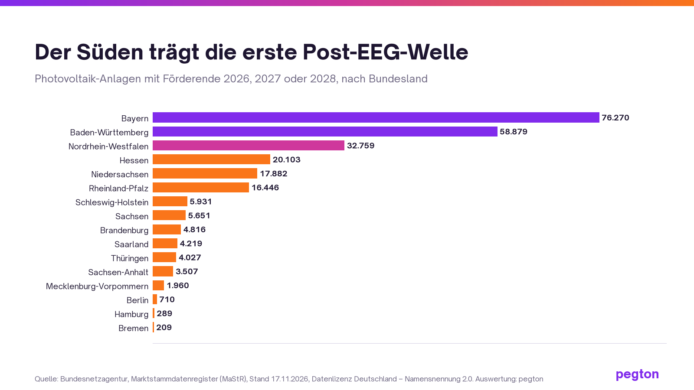

Wie viele Solaranlagen verlieren in Ihrem Kreis die EEG-Vergütung? Die Tabelle unten zeigt es für **alle 400 Kreise und kreisfreien Städte**. Die Daten gibt es kostenlos als CSV unter CC BY 4.0, für Redaktionen, Kommunen, Energieagenturen, Forschung oder eigene Karten.

**Download:** [GitHub: Zapparelo/post-eeg-solar-germany](https://github.com/Zapparelo/post-eeg-solar-germany) ·
[kreise_uebersicht.csv](https://raw.githubusercontent.com/Zapparelo/post-eeg-solar-germany/main/data/kreise_uebersicht.csv) ·
[kreise_nach_eeg_ende.csv](https://raw.githubusercontent.com/Zapparelo/post-eeg-solar-germany/main/data/kreise_nach_eeg_ende.csv) (mit kWp, Anteil privat, Anteil Volleinspeisung) ·
[bundeslaender_nach_eeg_ende.csv](https://raw.githubusercontent.com/Zapparelo/post-eeg-solar-germany/main/data/bundeslaender_nach_eeg_ende.csv) ·
[deutschland_nach_eeg_ende_und_groesse.csv](https://raw.githubusercontent.com/Zapparelo/post-eeg-solar-germany/main/data/deutschland_nach_eeg_ende_und_groesse.csv)

**Namensnennung bei Weiterverwendung:** „Datenquelle: Marktstammdatenregister, Bundesnetzagentur (dl-de/by-2-0); Aggregation: pegton (zapparelo.github.io/daten)“

## Alle Kreise

Förderende jeweils am 31.12. des Jahres. „Bis 2025“ heißt: die Anlage ist schon ausgefördert. Die Spalte AGS ist der amtliche Kreisschlüssel; manche Namen gibt es doppelt (z. B. Stadt und Landkreis Würzburg). Gezählt sind Anlagen mit Inbetriebnahme 2000–2008, die laut Register in Betrieb sind. Wie gezählt wird, steht unter [Methodik](/methodik/).

| Bundesland | Kreis | AGS | bis 2025 | 2026 | 2027 | 2028 | gesamt |
|---|---|---|---:|---:|---:|---:|---:|
| Baden-Württemberg | Alb-Donau-Kreis | 08425 | 1.454 | 471 | 772 | 1.161 | 3.858 |
| Baden-Württemberg | Baden-Baden | 08211 | 130 | 46 | 44 | 63 | 283 |
| Baden-Württemberg | Biberach | 08426 | 1.521 | 511 | 770 | 1.306 | 4.108 |
| Baden-Württemberg | Bodenseekreis | 08435 | 758 | 252 | 287 | 521 | 1.818 |
| Baden-Württemberg | Breisgau-Hochschwarzwald | 08315 | 1.300 | 506 | 480 | 558 | 2.844 |
| Baden-Württemberg | Böblingen | 08115 | 804 | 296 | 372 | 539 | 2.011 |
| Baden-Württemberg | Calw | 08235 | 536 | 257 | 327 | 494 | 1.614 |
| Baden-Württemberg | Emmendingen | 08316 | 838 | 283 | 344 | 342 | 1.807 |
| Baden-Württemberg | Enzkreis | 08236 | 1.298 | 458 | 459 | 587 | 2.802 |
| Baden-Württemberg | Esslingen | 08116 | 1.063 | 493 | 556 | 722 | 2.834 |
| Baden-Württemberg | Freiburg im Breisgau | 08311 | 473 | 138 | 122 | 151 | 884 |
| Baden-Württemberg | Freudenstadt | 08237 | 614 | 187 | 306 | 416 | 1.523 |
| Baden-Württemberg | Göppingen | 08117 | 732 | 369 | 338 | 494 | 1.933 |
| Baden-Württemberg | Heidelberg | 08221 | 57 | 27 | 27 | 53 | 164 |
| Baden-Württemberg | Heidenheim | 08135 | 824 | 243 | 246 | 384 | 1.697 |
| Baden-Württemberg | Heilbronn | 08125 | 2.169 | 672 | 810 | 1.214 | 4.865 |
| Baden-Württemberg | Heilbronn | 08121 | 270 | 72 | 79 | 97 | 518 |
| Baden-Württemberg | Hohenlohekreis | 08126 | 837 | 226 | 302 | 629 | 1.994 |
| Baden-Württemberg | Karlsruhe | 08215 | 1.146 | 900 | 840 | 1.022 | 3.908 |
| Baden-Württemberg | Karlsruhe | 08212 | 134 | 80 | 111 | 128 | 453 |
| Baden-Württemberg | Konstanz | 08335 | 1.122 | 390 | 383 | 538 | 2.433 |
| Baden-Württemberg | Ludwigsburg | 08118 | 1.082 | 385 | 498 | 804 | 2.769 |
| Baden-Württemberg | Lörrach | 08336 | 547 | 296 | 264 | 349 | 1.456 |
| Baden-Württemberg | Main-Tauber-Kreis | 08128 | 1.263 | 280 | 321 | 603 | 2.467 |
| Baden-Württemberg | Mannheim | 08222 | 122 | 75 | 123 | 142 | 462 |
| Baden-Württemberg | Neckar-Odenwald-Kreis | 08225 | 865 | 413 | 519 | 705 | 2.502 |
| Baden-Württemberg | Ortenaukreis | 08317 | 1.762 | 701 | 742 | 1.067 | 4.272 |
| Baden-Württemberg | Ostalbkreis | 08136 | 1.477 | 478 | 668 | 1.065 | 3.688 |
| Baden-Württemberg | Pforzheim | 08231 | 251 | 81 | 72 | 102 | 506 |
| Baden-Württemberg | Rastatt | 08216 | 723 | 289 | 410 | 598 | 2.020 |
| Baden-Württemberg | Ravensburg | 08436 | 2.118 | 534 | 775 | 1.134 | 4.561 |
| Baden-Württemberg | Rems-Murr-Kreis | 08119 | 1.034 | 358 | 503 | 702 | 2.597 |
| Baden-Württemberg | Reutlingen | 08415 | 1.107 | 358 | 491 | 743 | 2.699 |
| Baden-Württemberg | Rhein-Neckar-Kreis | 08226 | 1.164 | 718 | 855 | 942 | 3.679 |
| Baden-Württemberg | Rottweil | 08325 | 990 | 332 | 320 | 520 | 2.162 |
| Baden-Württemberg | Schwarzwald-Baar-Kreis | 08326 | 722 | 357 | 469 | 543 | 2.091 |
| Baden-Württemberg | Schwäbisch Hall | 08127 | 1.591 | 554 | 943 | 1.371 | 4.459 |
| Baden-Württemberg | Sigmaringen | 08437 | 858 | 246 | 375 | 636 | 2.115 |
| Baden-Württemberg | Stuttgart | 08111 | 311 | 128 | 126 | 197 | 762 |
| Baden-Württemberg | Tuttlingen | 08327 | 658 | 210 | 260 | 383 | 1.511 |
| Baden-Württemberg | Tübingen | 08416 | 598 | 223 | 353 | 471 | 1.645 |
| Baden-Württemberg | Ulm | 08421 | 220 | 102 | 163 | 167 | 652 |
| Baden-Württemberg | Waldshut | 08337 | 980 | 360 | 370 | 570 | 2.280 |
| Baden-Württemberg | Zollernalbkreis | 08417 | 635 | 285 | 554 | 834 | 2.308 |
| Bayern | Aichach-Friedberg | 09771 | 801 | 173 | 264 | 395 | 1.633 |
| Bayern | Altötting | 09171 | 1.034 | 280 | 412 | 792 | 2.518 |
| Bayern | Amberg | 09361 | 121 | 48 | 31 | 70 | 270 |
| Bayern | Amberg-Sulzbach | 09371 | 928 | 365 | 331 | 504 | 2.128 |
| Bayern | Ansbach | 09571 | 2.231 | 552 | 640 | 1.169 | 4.592 |
| Bayern | Ansbach | 09561 | 159 | 26 | 60 | 84 | 329 |
| Bayern | Aschaffenburg | 09671 | 554 | 338 | 420 | 362 | 1.674 |
| Bayern | Aschaffenburg | 09661 | 99 | 69 | 54 | 67 | 289 |
| Bayern | Augsburg | 09772 | 1.321 | 379 | 515 | 680 | 2.895 |
| Bayern | Augsburg | 09761 | 125 | 49 | 69 | 87 | 330 |
| Bayern | Bad Kissingen | 09672 | 495 | 111 | 147 | 181 | 934 |
| Bayern | Bad Tölz-Wolfratshausen | 09173 | 477 | 106 | 130 | 216 | 929 |
| Bayern | Bamberg | 09471 | 660 | 357 | 215 | 439 | 1.671 |
| Bayern | Bamberg | 09461 | 83 | 27 | 22 | 55 | 187 |
| Bayern | Bayreuth | 09472 | 472 | 189 | 184 | 352 | 1.197 |
| Bayern | Bayreuth | 09462 | 75 | 36 | 26 | 53 | 190 |
| Bayern | Berchtesgadener Land | 09172 | 374 | 101 | 121 | 170 | 766 |
| Bayern | Cham | 09372 | 1.197 | 377 | 458 | 897 | 2.929 |
| Bayern | Coburg | 09473 | 373 | 165 | 88 | 168 | 794 |
| Bayern | Coburg | 09463 | 69 | 32 | 25 | 26 | 152 |
| Bayern | Dachau | 09174 | 654 | 162 | 195 | 326 | 1.337 |
| Bayern | Deggendorf | 09271 | 1.091 | 301 | 537 | 981 | 2.910 |
| Bayern | Dillingen a.d. Donau | 09773 | 920 | 171 | 307 | 522 | 1.920 |
| Bayern | Dingolfing-Landau | 09279 | 1.305 | 354 | 726 | 1.289 | 3.674 |
| Bayern | Donau-Ries | 09779 | 1.364 | 307 | 563 | 1.012 | 3.246 |
| Bayern | Ebersberg | 09175 | 460 | 104 | 119 | 218 | 901 |
| Bayern | Eichstätt | 09176 | 1.260 | 303 | 460 | 819 | 2.842 |
| Bayern | Erding | 09177 | 563 | 167 | 219 | 397 | 1.346 |
| Bayern | Erlangen | 09562 | 187 | 39 | 88 | 50 | 364 |
| Bayern | Erlangen-Höchstadt | 09572 | 439 | 150 | 213 | 282 | 1.084 |
| Bayern | Forchheim | 09474 | 352 | 143 | 179 | 303 | 977 |
| Bayern | Freising | 09178 | 720 | 170 | 250 | 429 | 1.569 |
| Bayern | Freyung-Grafenau | 09272 | 1.180 | 291 | 317 | 475 | 2.263 |
| Bayern | Fürstenfeldbruck | 09179 | 521 | 92 | 143 | 313 | 1.069 |
| Bayern | Fürth | 09573 | 393 | 112 | 114 | 177 | 796 |
| Bayern | Fürth | 09563 | 139 | 44 | 53 | 50 | 286 |
| Bayern | Garmisch-Partenkirchen | 09180 | 367 | 72 | 68 | 110 | 617 |
| Bayern | Günzburg | 09774 | 639 | 183 | 256 | 484 | 1.562 |
| Bayern | Haßberge | 09674 | 495 | 201 | 139 | 251 | 1.086 |
| Bayern | Hof | 09475 | 331 | 140 | 94 | 155 | 720 |
| Bayern | Hof | 09464 | 44 | 18 | 21 | 19 | 102 |
| Bayern | Ingolstadt | 09161 | 264 | 104 | 125 | 173 | 666 |
| Bayern | Kaufbeuren | 09762 | 131 | 39 | 32 | 44 | 246 |
| Bayern | Kelheim | 09273 | 1.413 | 381 | 580 | 973 | 3.347 |
| Bayern | Kempten (Allgäu) | 09763 | 201 | 51 | 59 | 44 | 355 |
| Bayern | Kitzingen | 09675 | 729 | 149 | 185 | 175 | 1.238 |
| Bayern | Kronach | 09476 | 169 | 66 | 49 | 73 | 357 |
| Bayern | Kulmbach | 09477 | 402 | 123 | 118 | 175 | 818 |
| Bayern | Landsberg am Lech | 09181 | 831 | 184 | 267 | 343 | 1.625 |
| Bayern | Landshut | 09274 | 1.698 | 331 | 433 | 990 | 3.452 |
| Bayern | Landshut | 09261 | 112 | 37 | 39 | 63 | 251 |
| Bayern | Lichtenfels | 09478 | 306 | 76 | 101 | 128 | 611 |
| Bayern | Lindau (Bodensee) | 09776 | 544 | 171 | 206 | 302 | 1.223 |
| Bayern | Main-Spessart | 09677 | 1.197 | 240 | 162 | 213 | 1.812 |
| Bayern | Memmingen | 09764 | 192 | 82 | 70 | 76 | 420 |
| Bayern | Miesbach | 09182 | 339 | 108 | 144 | 159 | 750 |
| Bayern | Miltenberg | 09676 | 348 | 220 | 206 | 258 | 1.032 |
| Bayern | Mühldorf a. Inn | 09183 | 629 | 130 | 271 | 468 | 1.498 |
| Bayern | München | 09184 | 500 | 138 | 148 | 279 | 1.065 |
| Bayern | München | 09162 | 417 | 118 | 151 | 223 | 909 |
| Bayern | Neu-Ulm | 09775 | 728 | 222 | 328 | 489 | 1.767 |
| Bayern | Neuburg-Schrobenhausen | 09185 | 772 | 144 | 245 | 469 | 1.630 |
| Bayern | Neumarkt i.d. OPf. | 09373 | 1.083 | 288 | 311 | 549 | 2.231 |
| Bayern | Neustadt a.d. Aisch-Bad Windsheim | 09575 | 1.545 | 303 | 386 | 511 | 2.745 |
| Bayern | Neustadt a.d. Waldnaab | 09374 | 1.051 | 323 | 218 | 354 | 1.946 |
| Bayern | Nürnberg | 09564 | 280 | 119 | 111 | 152 | 662 |
| Bayern | Nürnberger Land | 09574 | 528 | 177 | 216 | 222 | 1.143 |
| Bayern | Oberallgäu | 09780 | 1.433 | 428 | 441 | 544 | 2.846 |
| Bayern | Ostallgäu | 09777 | 2.216 | 481 | 512 | 771 | 3.980 |
| Bayern | Passau | 09275 | 2.349 | 616 | 654 | 1.136 | 4.755 |
| Bayern | Passau | 09262 | 153 | 62 | 24 | 57 | 296 |
| Bayern | Pfaffenhofen a.d. Ilm | 09186 | 804 | 204 | 210 | 374 | 1.592 |
| Bayern | Regen | 09276 | 799 | 188 | 245 | 449 | 1.681 |
| Bayern | Regensburg | 09375 | 1.749 | 595 | 499 | 819 | 3.662 |
| Bayern | Regensburg | 09362 | 316 | 111 | 105 | 93 | 625 |
| Bayern | Rhön-Grabfeld | 09673 | 416 | 97 | 124 | 187 | 824 |
| Bayern | Rosenheim | 09187 | 1.439 | 366 | 488 | 810 | 3.103 |
| Bayern | Rosenheim | 09163 | 89 | 25 | 37 | 57 | 208 |
| Bayern | Roth | 09576 | 624 | 191 | 168 | 323 | 1.306 |
| Bayern | Rottal-Inn | 09277 | 1.917 | 447 | 718 | 1.358 | 4.440 |
| Bayern | Schwabach | 09565 | 67 | 22 | 21 | 22 | 132 |
| Bayern | Schwandorf | 09376 | 1.196 | 526 | 405 | 705 | 2.832 |
| Bayern | Schweinfurt | 09678 | 936 | 145 | 195 | 258 | 1.534 |
| Bayern | Schweinfurt | 09662 | 41 | 17 | 15 | 19 | 92 |
| Bayern | Starnberg | 09188 | 374 | 80 | 103 | 165 | 722 |
| Bayern | Straubing | 09263 | 84 | 32 | 68 | 94 | 278 |
| Bayern | Straubing-Bogen | 09278 | 1.099 | 279 | 583 | 1.035 | 2.996 |
| Bayern | Tirschenreuth | 09377 | 549 | 115 | 200 | 205 | 1.069 |
| Bayern | Traunstein | 09189 | 1.601 | 410 | 405 | 500 | 2.916 |
| Bayern | Unterallgäu | 09778 | 2.067 | 408 | 584 | 901 | 3.960 |
| Bayern | Weiden i.d. OPf. | 09363 | 132 | 53 | 69 | 47 | 301 |
| Bayern | Weilheim-Schongau | 09190 | 1.233 | 220 | 302 | 481 | 2.236 |
| Bayern | Weißenburg-Gunzenhausen | 09577 | 677 | 183 | 306 | 517 | 1.683 |
| Bayern | Wunsiedel i. Fichtelgebirge | 09479 | 210 | 78 | 70 | 104 | 462 |
| Bayern | Würzburg | 09679 | 910 | 178 | 242 | 401 | 1.731 |
| Bayern | Würzburg | 09663 | 110 | 32 | 28 | 55 | 225 |
| Berlin | Berlin | 11000 | 510 | 142 | 222 | 345 | 1.219 |
| Brandenburg | Barnim | 12060 | 73 | 58 | 123 | 154 | 408 |
| Brandenburg | Brandenburg an der Havel | 12051 | 20 | 9 | 21 | 20 | 70 |
| Brandenburg | Cottbus | 12052 | 38 | 19 | 106 | 62 | 225 |
| Brandenburg | Dahme-Spreewald | 12061 | 98 | 65 | 103 | 156 | 422 |
| Brandenburg | Elbe-Elster | 12062 | 139 | 62 | 118 | 172 | 491 |
| Brandenburg | Frankfurt (Oder) | 12053 | 14 | 12 | 34 | 30 | 90 |
| Brandenburg | Havelland | 12063 | 61 | 33 | 80 | 126 | 300 |
| Brandenburg | Märkisch-Oderland | 12064 | 82 | 107 | 164 | 240 | 593 |
| Brandenburg | Oberhavel | 12065 | 54 | 54 | 52 | 139 | 299 |
| Brandenburg | Oberspreewald-Lausitz | 12066 | 71 | 49 | 84 | 131 | 335 |
| Brandenburg | Oder-Spree | 12067 | 85 | 106 | 180 | 276 | 647 |
| Brandenburg | Ostprignitz-Ruppin | 12068 | 53 | 21 | 35 | 82 | 191 |
| Brandenburg | Potsdam | 12054 | 16 | 11 | 9 | 15 | 51 |
| Brandenburg | Potsdam-Mittelmark | 12069 | 128 | 101 | 145 | 171 | 545 |
| Brandenburg | Prignitz | 12070 | 65 | 34 | 43 | 102 | 244 |
| Brandenburg | Spree-Neiße | 12071 | 101 | 67 | 98 | 164 | 430 |
| Brandenburg | Teltow-Fläming | 12072 | 65 | 71 | 79 | 123 | 338 |
| Brandenburg | Uckermark | 12073 | 78 | 60 | 76 | 163 | 377 |
| Bremen | Bremen | 04011 | 146 | 53 | 47 | 60 | 306 |
| Bremen | Bremerhaven | 04012 | 39 | 19 | 15 | 16 | 89 |
| Hamburg | Hamburg | 02000 | 243 | 90 | 88 | 111 | 532 |
| Hessen | Bergstraße | 06431 | 481 | 303 | 307 | 388 | 1.479 |
| Hessen | Darmstadt | 06411 | 75 | 35 | 42 | 41 | 193 |
| Hessen | Darmstadt-Dieburg | 06432 | 437 | 372 | 439 | 475 | 1.723 |
| Hessen | Frankfurt am Main | 06412 | 103 | 37 | 61 | 95 | 296 |
| Hessen | Fulda | 06631 | 708 | 335 | 471 | 594 | 2.108 |
| Hessen | Gießen | 06531 | 428 | 296 | 334 | 336 | 1.394 |
| Hessen | Groß-Gerau | 06433 | 294 | 190 | 235 | 279 | 998 |
| Hessen | Hersfeld-Rotenburg | 06632 | 551 | 142 | 212 | 294 | 1.199 |
| Hessen | Hochtaunuskreis | 06434 | 110 | 76 | 94 | 105 | 385 |
| Hessen | Kassel | 06633 | 671 | 435 | 672 | 735 | 2.513 |
| Hessen | Kassel | 06611 | 132 | 73 | 104 | 145 | 454 |
| Hessen | Lahn-Dill-Kreis | 06532 | 508 | 304 | 404 | 539 | 1.755 |
| Hessen | Limburg-Weilburg | 06533 | 307 | 240 | 233 | 296 | 1.076 |
| Hessen | Main-Kinzig-Kreis | 06435 | 826 | 296 | 359 | 644 | 2.125 |
| Hessen | Main-Taunus-Kreis | 06436 | 136 | 61 | 108 | 153 | 458 |
| Hessen | Marburg-Biedenkopf | 06534 | 471 | 278 | 270 | 378 | 1.397 |
| Hessen | Odenwaldkreis | 06437 | 281 | 126 | 154 | 137 | 698 |
| Hessen | Offenbach | 06438 | 208 | 143 | 191 | 246 | 788 |
| Hessen | Offenbach am Main | 06413 | 19 | 12 | 21 | 43 | 95 |
| Hessen | Rheingau-Taunus-Kreis | 06439 | 124 | 108 | 145 | 221 | 598 |
| Hessen | Schwalm-Eder-Kreis | 06634 | 720 | 427 | 538 | 850 | 2.535 |
| Hessen | Vogelsbergkreis | 06535 | 531 | 186 | 177 | 235 | 1.129 |
| Hessen | Waldeck-Frankenberg | 06635 | 661 | 298 | 339 | 557 | 1.855 |
| Hessen | Werra-Meißner-Kreis | 06636 | 228 | 216 | 263 | 328 | 1.035 |
| Hessen | Wetteraukreis | 06440 | 438 | 193 | 182 | 327 | 1.140 |
| Hessen | Wiesbaden | 06414 | 85 | 30 | 43 | 52 | 210 |
| Mecklenburg-Vorpommern | Ludwigslust-Parchim | 13076 | 151 | 70 | 97 | 124 | 442 |
| Mecklenburg-Vorpommern | Mecklenburgische Seenplatte | 13071 | 100 | 83 | 75 | 100 | 358 |
| Mecklenburg-Vorpommern | Nordwestmecklenburg | 13074 | 104 | 35 | 61 | 95 | 295 |
| Mecklenburg-Vorpommern | Rostock | 13072 | 138 | 68 | 100 | 196 | 502 |
| Mecklenburg-Vorpommern | Rostock | 13003 | 57 | 23 | 28 | 40 | 148 |
| Mecklenburg-Vorpommern | Schwerin | 13004 | 24 | 8 | 19 | 16 | 67 |
| Mecklenburg-Vorpommern | Vorpommern-Greifswald | 13075 | 158 | 106 | 109 | 138 | 511 |
| Mecklenburg-Vorpommern | Vorpommern-Rügen | 13073 | 146 | 75 | 112 | 183 | 516 |
| Niedersachsen | Ammerland | 03451 | 181 | 94 | 85 | 116 | 476 |
| Niedersachsen | Aurich | 03452 | 444 | 384 | 329 | 345 | 1.502 |
| Niedersachsen | Braunschweig | 03101 | 102 | 34 | 70 | 87 | 293 |
| Niedersachsen | Celle | 03351 | 187 | 59 | 68 | 118 | 432 |
| Niedersachsen | Cloppenburg | 03453 | 427 | 144 | 162 | 233 | 966 |
| Niedersachsen | Cuxhaven | 03352 | 260 | 92 | 81 | 139 | 572 |
| Niedersachsen | Delmenhorst | 03401 | 57 | 9 | 16 | 19 | 101 |
| Niedersachsen | Diepholz | 03251 | 601 | 222 | 209 | 222 | 1.254 |
| Niedersachsen | Emden | 03402 | 52 | 43 | 22 | 26 | 143 |
| Niedersachsen | Emsland | 03454 | 893 | 543 | 412 | 555 | 2.403 |
| Niedersachsen | Friesland | 03455 | 130 | 82 | 68 | 114 | 394 |
| Niedersachsen | Gifhorn | 03151 | 153 | 135 | 191 | 238 | 717 |
| Niedersachsen | Goslar | 03153 | 120 | 61 | 76 | 114 | 371 |
| Niedersachsen | Grafschaft Bentheim | 03456 | 197 | 258 | 114 | 140 | 709 |
| Niedersachsen | Göttingen | 03159 | 772 | 346 | 320 | 342 | 1.780 |
| Niedersachsen | Hameln-Pyrmont | 03252 | 207 | 91 | 76 | 121 | 495 |
| Niedersachsen | Harburg | 03353 | 205 | 78 | 97 | 123 | 503 |
| Niedersachsen | Heidekreis | 03358 | 150 | 59 | 65 | 103 | 377 |
| Niedersachsen | Helmstedt | 03154 | 98 | 70 | 86 | 115 | 369 |
| Niedersachsen | Hildesheim | 03254 | 263 | 86 | 126 | 265 | 740 |
| Niedersachsen | Holzminden | 03255 | 78 | 38 | 59 | 62 | 237 |
| Niedersachsen | Leer | 03457 | 181 | 129 | 118 | 161 | 589 |
| Niedersachsen | Lüchow-Dannenberg | 03354 | 225 | 44 | 36 | 46 | 351 |
| Niedersachsen | Lüneburg | 03355 | 171 | 77 | 98 | 124 | 470 |
| Niedersachsen | Nienburg (Weser) | 03256 | 277 | 118 | 127 | 153 | 675 |
| Niedersachsen | Northeim | 03155 | 309 | 104 | 133 | 190 | 736 |
| Niedersachsen | Oldenburg | 03458 | 299 | 118 | 133 | 189 | 739 |
| Niedersachsen | Oldenburg (Oldb) | 03403 | 119 | 38 | 40 | 66 | 263 |
| Niedersachsen | Osnabrück | 03459 | 657 | 224 | 288 | 506 | 1.675 |
| Niedersachsen | Osnabrück | 03404 | 109 | 28 | 46 | 64 | 247 |
| Niedersachsen | Osterholz | 03356 | 177 | 48 | 92 | 101 | 418 |
| Niedersachsen | Peine | 03157 | 108 | 72 | 92 | 140 | 412 |
| Niedersachsen | Region Hannover | 03241 | 593 | 232 | 333 | 470 | 1.628 |
| Niedersachsen | Rotenburg (Wümme) | 03357 | 389 | 92 | 112 | 117 | 710 |
| Niedersachsen | Salzgitter | 03102 | 64 | 36 | 40 | 55 | 195 |
| Niedersachsen | Schaumburg | 03257 | 159 | 85 | 102 | 200 | 546 |
| Niedersachsen | Stade | 03359 | 345 | 108 | 82 | 130 | 665 |
| Niedersachsen | Uelzen | 03360 | 190 | 70 | 58 | 66 | 384 |
| Niedersachsen | Vechta | 03460 | 135 | 152 | 212 | 357 | 856 |
| Niedersachsen | Verden | 03361 | 125 | 33 | 59 | 95 | 312 |
| Niedersachsen | Wesermarsch | 03461 | 100 | 86 | 66 | 167 | 419 |
| Niedersachsen | Wilhelmshaven | 03405 | 26 | 18 | 21 | 36 | 101 |
| Niedersachsen | Wittmund | 03462 | 160 | 103 | 100 | 102 | 465 |
| Niedersachsen | Wolfenbüttel | 03158 | 158 | 106 | 188 | 244 | 696 |
| Niedersachsen | Wolfsburg | 03103 | 59 | 25 | 56 | 62 | 202 |
| Nordrhein-Westfalen | Bielefeld | 05711 | 312 | 77 | 64 | 117 | 570 |
| Nordrhein-Westfalen | Bochum | 05911 | 93 | 41 | 92 | 138 | 364 |
| Nordrhein-Westfalen | Bonn | 05314 | 113 | 48 | 41 | 59 | 261 |
| Nordrhein-Westfalen | Borken | 05554 | 1.384 | 565 | 717 | 1.013 | 3.679 |
| Nordrhein-Westfalen | Bottrop | 05512 | 49 | 16 | 31 | 58 | 154 |
| Nordrhein-Westfalen | Coesfeld | 05558 | 640 | 274 | 388 | 613 | 1.915 |
| Nordrhein-Westfalen | Dortmund | 05913 | 283 | 165 | 221 | 278 | 947 |
| Nordrhein-Westfalen | Duisburg | 05112 | 66 | 29 | 43 | 74 | 212 |
| Nordrhein-Westfalen | Düren | 05358 | 321 | 166 | 181 | 309 | 977 |
| Nordrhein-Westfalen | Düsseldorf | 05111 | 97 | 32 | 73 | 131 | 333 |
| Nordrhein-Westfalen | Ennepe-Ruhr-Kreis | 05954 | 183 | 86 | 133 | 139 | 541 |
| Nordrhein-Westfalen | Essen | 05113 | 99 | 61 | 142 | 151 | 453 |
| Nordrhein-Westfalen | Euskirchen | 05366 | 328 | 206 | 277 | 580 | 1.391 |
| Nordrhein-Westfalen | Gelsenkirchen | 05513 | 105 | 17 | 48 | 60 | 230 |
| Nordrhein-Westfalen | Gütersloh | 05754 | 1.223 | 471 | 510 | 549 | 2.753 |
| Nordrhein-Westfalen | Hagen | 05914 | 64 | 30 | 34 | 33 | 161 |
| Nordrhein-Westfalen | Hamm | 05915 | 109 | 57 | 78 | 108 | 352 |
| Nordrhein-Westfalen | Heinsberg | 05370 | 271 | 152 | 255 | 445 | 1.123 |
| Nordrhein-Westfalen | Herford | 05758 | 364 | 131 | 107 | 172 | 774 |
| Nordrhein-Westfalen | Herne | 05916 | 23 | 11 | 23 | 24 | 81 |
| Nordrhein-Westfalen | Hochsauerlandkreis | 05958 | 595 | 342 | 339 | 487 | 1.763 |
| Nordrhein-Westfalen | Höxter | 05762 | 567 | 261 | 320 | 421 | 1.569 |
| Nordrhein-Westfalen | Kleve | 05154 | 663 | 232 | 327 | 523 | 1.745 |
| Nordrhein-Westfalen | Krefeld | 05114 | 99 | 52 | 55 | 91 | 297 |
| Nordrhein-Westfalen | Köln | 05315 | 144 | 51 | 80 | 189 | 464 |
| Nordrhein-Westfalen | Leverkusen | 05316 | 39 | 13 | 27 | 33 | 112 |
| Nordrhein-Westfalen | Lippe | 05766 | 721 | 210 | 232 | 269 | 1.432 |
| Nordrhein-Westfalen | Mettmann | 05158 | 202 | 57 | 96 | 173 | 528 |
| Nordrhein-Westfalen | Minden-Lübbecke | 05770 | 604 | 230 | 221 | 412 | 1.467 |
| Nordrhein-Westfalen | Märkischer Kreis | 05962 | 274 | 108 | 103 | 160 | 645 |
| Nordrhein-Westfalen | Mönchengladbach | 05116 | 66 | 35 | 55 | 97 | 253 |
| Nordrhein-Westfalen | Mülheim an der Ruhr | 05117 | 61 | 30 | 35 | 41 | 167 |
| Nordrhein-Westfalen | Münster | 05515 | 254 | 94 | 106 | 143 | 597 |
| Nordrhein-Westfalen | Oberbergischer Kreis | 05374 | 185 | 85 | 156 | 242 | 668 |
| Nordrhein-Westfalen | Oberhausen | 05119 | 53 | 21 | 31 | 33 | 138 |
| Nordrhein-Westfalen | Olpe | 05966 | 107 | 81 | 72 | 117 | 377 |
| Nordrhein-Westfalen | Paderborn | 05774 | 1.043 | 417 | 455 | 636 | 2.551 |
| Nordrhein-Westfalen | Recklinghausen | 05562 | 344 | 147 | 186 | 368 | 1.045 |
| Nordrhein-Westfalen | Remscheid | 05120 | 31 | 21 | 20 | 24 | 96 |
| Nordrhein-Westfalen | Rhein-Erft-Kreis | 05362 | 278 | 151 | 236 | 394 | 1.059 |
| Nordrhein-Westfalen | Rhein-Kreis Neuss | 05162 | 244 | 82 | 143 | 265 | 734 |
| Nordrhein-Westfalen | Rhein-Sieg-Kreis | 05382 | 560 | 293 | 385 | 608 | 1.846 |
| Nordrhein-Westfalen | Rheinisch-Bergischer Kreis | 05378 | 178 | 69 | 112 | 190 | 549 |
| Nordrhein-Westfalen | Siegen-Wittgenstein | 05970 | 322 | 210 | 161 | 225 | 918 |
| Nordrhein-Westfalen | Soest | 05974 | 818 | 303 | 411 | 593 | 2.125 |
| Nordrhein-Westfalen | Solingen | 05122 | 32 | 13 | 10 | 25 | 80 |
| Nordrhein-Westfalen | Steinfurt | 05566 | 1.435 | 516 | 674 | 985 | 3.610 |
| Nordrhein-Westfalen | Städteregion Aachen | 05334 | 290 | 104 | 192 | 306 | 892 |
| Nordrhein-Westfalen | Unna | 05978 | 432 | 252 | 353 | 421 | 1.458 |
| Nordrhein-Westfalen | Viersen | 05166 | 263 | 163 | 230 | 328 | 984 |
| Nordrhein-Westfalen | Warendorf | 05570 | 813 | 295 | 341 | 606 | 2.055 |
| Nordrhein-Westfalen | Wesel | 05170 | 468 | 245 | 293 | 395 | 1.401 |
| Nordrhein-Westfalen | Wuppertal | 05124 | 91 | 41 | 56 | 82 | 270 |
| Rheinland-Pfalz | Ahrweiler | 07131 | 136 | 83 | 196 | 214 | 629 |
| Rheinland-Pfalz | Altenkirchen (Westerwald) | 07132 | 239 | 120 | 132 | 112 | 603 |
| Rheinland-Pfalz | Alzey-Worms | 07331 | 262 | 234 | 245 | 359 | 1.100 |
| Rheinland-Pfalz | Bad Dürkheim | 07332 | 284 | 156 | 164 | 277 | 881 |
| Rheinland-Pfalz | Bad Kreuznach | 07133 | 284 | 229 | 216 | 346 | 1.075 |
| Rheinland-Pfalz | Bernkastel-Wittlich | 07231 | 238 | 142 | 170 | 276 | 826 |
| Rheinland-Pfalz | Birkenfeld | 07134 | 76 | 73 | 120 | 156 | 425 |
| Rheinland-Pfalz | Cochem-Zell | 07135 | 89 | 110 | 103 | 168 | 470 |
| Rheinland-Pfalz | Donnersbergkreis | 07333 | 254 | 118 | 138 | 276 | 786 |
| Rheinland-Pfalz | Eifelkreis Bitburg-Prüm | 07232 | 284 | 96 | 117 | 182 | 679 |
| Rheinland-Pfalz | Frankenthal (Pfalz) | 07311 | 31 | 30 | 30 | 50 | 141 |
| Rheinland-Pfalz | Germersheim | 07334 | 359 | 230 | 295 | 297 | 1.181 |
| Rheinland-Pfalz | Kaiserslautern | 07335 | 243 | 153 | 183 | 334 | 913 |
| Rheinland-Pfalz | Kaiserslautern | 07312 | 68 | 56 | 53 | 68 | 245 |
| Rheinland-Pfalz | Koblenz | 07111 | 37 | 29 | 28 | 70 | 164 |
| Rheinland-Pfalz | Kusel | 07336 | 124 | 116 | 170 | 300 | 710 |
| Rheinland-Pfalz | Landau in der Pfalz | 07313 | 155 | 52 | 57 | 49 | 313 |
| Rheinland-Pfalz | Ludwigshafen am Rhein | 07314 | 83 | 55 | 65 | 76 | 279 |
| Rheinland-Pfalz | Mainz | 07315 | 123 | 93 | 67 | 72 | 355 |
| Rheinland-Pfalz | Mainz-Bingen | 07339 | 290 | 281 | 308 | 353 | 1.232 |
| Rheinland-Pfalz | Mayen-Koblenz | 07137 | 197 | 204 | 227 | 309 | 937 |
| Rheinland-Pfalz | Neustadt an der Weinstraße | 07316 | 96 | 32 | 51 | 94 | 273 |
| Rheinland-Pfalz | Neuwied | 07138 | 160 | 150 | 171 | 202 | 683 |
| Rheinland-Pfalz | Pirmasens | 07317 | 29 | 15 | 31 | 45 | 120 |
| Rheinland-Pfalz | Rhein-Hunsrück-Kreis | 07140 | 228 | 181 | 163 | 353 | 925 |
| Rheinland-Pfalz | Rhein-Lahn-Kreis | 07141 | 163 | 112 | 133 | 185 | 593 |
| Rheinland-Pfalz | Rhein-Pfalz-Kreis | 07338 | 309 | 242 | 238 | 341 | 1.130 |
| Rheinland-Pfalz | Speyer | 07318 | 104 | 42 | 47 | 72 | 265 |
| Rheinland-Pfalz | Südliche Weinstraße | 07337 | 675 | 332 | 273 | 336 | 1.616 |
| Rheinland-Pfalz | Südwestpfalz | 07340 | 146 | 139 | 168 | 345 | 798 |
| Rheinland-Pfalz | Trier | 07211 | 36 | 18 | 21 | 59 | 134 |
| Rheinland-Pfalz | Trier-Saarburg | 07235 | 156 | 107 | 132 | 169 | 564 |
| Rheinland-Pfalz | Vulkaneifel | 07233 | 183 | 89 | 84 | 131 | 487 |
| Rheinland-Pfalz | Westerwaldkreis | 07143 | 227 | 191 | 240 | 318 | 976 |
| Rheinland-Pfalz | Worms | 07319 | 72 | 42 | 57 | 89 | 260 |
| Rheinland-Pfalz | Zweibrücken | 07320 | 17 | 19 | 34 | 66 | 136 |
| Saarland | Merzig-Wadern | 10042 | 165 | 99 | 232 | 430 | 926 |
| Saarland | Neunkirchen | 10043 | 131 | 70 | 118 | 386 | 705 |
| Saarland | Regionalverband Saarbrücken | 10041 | 195 | 147 | 193 | 380 | 915 |
| Saarland | Saarlouis | 10044 | 252 | 151 | 204 | 591 | 1.198 |
| Saarland | Saarpfalz-Kreis | 10045 | 169 | 139 | 164 | 406 | 878 |
| Saarland | St. Wendel | 10046 | 119 | 72 | 124 | 313 | 628 |
| Sachsen | Bautzen | 14625 | 160 | 134 | 237 | 408 | 939 |
| Sachsen | Chemnitz | 14511 | 62 | 30 | 45 | 57 | 194 |
| Sachsen | Dresden | 14612 | 146 | 64 | 65 | 89 | 364 |
| Sachsen | Erzgebirgskreis | 14521 | 220 | 95 | 133 | 193 | 641 |
| Sachsen | Görlitz | 14626 | 166 | 109 | 141 | 268 | 684 |
| Sachsen | Leipzig | 14729 | 224 | 98 | 192 | 226 | 740 |
| Sachsen | Leipzig | 14713 | 89 | 54 | 53 | 89 | 285 |
| Sachsen | Meißen | 14627 | 160 | 95 | 108 | 253 | 616 |
| Sachsen | Mittelsachsen | 14522 | 318 | 175 | 220 | 330 | 1.043 |
| Sachsen | Nordsachsen | 14730 | 166 | 100 | 148 | 298 | 712 |
| Sachsen | Sächsische Schweiz-Osterzgebirge | 14628 | 168 | 64 | 98 | 163 | 493 |
| Sachsen | Vogtlandkreis | 14523 | 174 | 96 | 114 | 197 | 581 |
| Sachsen | Zwickau | 14524 | 184 | 107 | 107 | 199 | 597 |
| Sachsen-Anhalt | Altmarkkreis Salzwedel | 15081 | 147 | 117 | 87 | 96 | 447 |
| Sachsen-Anhalt | Anhalt-Bitterfeld | 15082 | 83 | 88 | 90 | 154 | 415 |
| Sachsen-Anhalt | Burgenlandkreis | 15084 | 124 | 89 | 120 | 145 | 478 |
| Sachsen-Anhalt | Börde | 15083 | 88 | 65 | 101 | 153 | 407 |
| Sachsen-Anhalt | Dessau-Roßlau | 15001 | 36 | 20 | 25 | 44 | 125 |
| Sachsen-Anhalt | Halle (Saale) | 15002 | 31 | 37 | 13 | 40 | 121 |
| Sachsen-Anhalt | Harz | 15085 | 125 | 75 | 77 | 148 | 425 |
| Sachsen-Anhalt | Jerichower Land | 15086 | 68 | 33 | 48 | 86 | 235 |
| Sachsen-Anhalt | Magdeburg | 15003 | 34 | 14 | 32 | 63 | 143 |
| Sachsen-Anhalt | Mansfeld-Südharz | 15087 | 73 | 56 | 86 | 103 | 318 |
| Sachsen-Anhalt | Saalekreis | 15088 | 108 | 76 | 118 | 204 | 506 |
| Sachsen-Anhalt | Salzlandkreis | 15089 | 71 | 31 | 44 | 89 | 235 |
| Sachsen-Anhalt | Stendal | 15090 | 129 | 81 | 68 | 61 | 339 |
| Sachsen-Anhalt | Wittenberg | 15091 | 155 | 117 | 129 | 183 | 584 |
| Schleswig-Holstein | Dithmarschen | 01051 | 364 | 242 | 337 | 523 | 1.466 |
| Schleswig-Holstein | Flensburg | 01001 | 13 | 8 | 10 | 16 | 47 |
| Schleswig-Holstein | Herzogtum Lauenburg | 01053 | 96 | 42 | 93 | 117 | 348 |
| Schleswig-Holstein | Kiel | 01002 | 52 | 17 | 10 | 28 | 107 |
| Schleswig-Holstein | Lübeck | 01003 | 34 | 16 | 20 | 33 | 103 |
| Schleswig-Holstein | Neumünster | 01004 | 21 | 7 | 10 | 15 | 53 |
| Schleswig-Holstein | Nordfriesland | 01054 | 717 | 372 | 342 | 563 | 1.994 |
| Schleswig-Holstein | Ostholstein | 01055 | 140 | 68 | 134 | 229 | 571 |
| Schleswig-Holstein | Pinneberg | 01056 | 161 | 49 | 86 | 104 | 400 |
| Schleswig-Holstein | Plön | 01057 | 99 | 34 | 64 | 97 | 294 |
| Schleswig-Holstein | Rendsburg-Eckernförde | 01058 | 337 | 149 | 180 | 195 | 861 |
| Schleswig-Holstein | Schleswig-Flensburg | 01059 | 464 | 252 | 291 | 425 | 1.432 |
| Schleswig-Holstein | Segeberg | 01060 | 122 | 77 | 98 | 126 | 423 |
| Schleswig-Holstein | Steinburg | 01061 | 108 | 42 | 80 | 88 | 318 |
| Schleswig-Holstein | Stormarn | 01062 | 116 | 76 | 77 | 89 | 358 |
| Thüringen | Altenburger Land | 16077 | 126 | 46 | 37 | 110 | 319 |
| Thüringen | Eichsfeld | 16061 | 130 | 121 | 127 | 172 | 550 |
| Thüringen | Erfurt | 16051 | 83 | 36 | 39 | 62 | 220 |
| Thüringen | Gera | 16052 | 27 | 18 | 13 | 25 | 83 |
| Thüringen | Gotha | 16067 | 80 | 171 | 141 | 193 | 585 |
| Thüringen | Greiz | 16076 | 111 | 69 | 61 | 97 | 338 |
| Thüringen | Hildburghausen | 16069 | 105 | 70 | 83 | 155 | 413 |
| Thüringen | Ilm-Kreis | 16070 | 103 | 36 | 34 | 77 | 250 |
| Thüringen | Jena | 16053 | 24 | 14 | 33 | 40 | 111 |
| Thüringen | Kyffhäuserkreis | 16065 | 36 | 28 | 38 | 60 | 162 |
| Thüringen | Nordhausen | 16062 | 43 | 21 | 36 | 72 | 172 |
| Thüringen | Saale-Holzland-Kreis | 16074 | 59 | 37 | 71 | 80 | 247 |
| Thüringen | Saale-Orla-Kreis | 16075 | 93 | 51 | 92 | 96 | 332 |
| Thüringen | Saalfeld-Rudolstadt | 16073 | 64 | 38 | 46 | 62 | 210 |
| Thüringen | Schmalkalden-Meiningen | 16066 | 121 | 58 | 58 | 62 | 299 |
| Thüringen | Sonneberg | 16072 | 48 | 27 | 21 | 19 | 115 |
| Thüringen | Suhl | 16054 | 19 | 10 | 11 | 12 | 52 |
| Thüringen | Sömmerda | 16068 | 49 | 28 | 33 | 63 | 173 |
| Thüringen | Unstrut-Hainich-Kreis | 16064 | 64 | 22 | 75 | 108 | 269 |
| Thüringen | Wartburgkreis | 16063 | 103 | 53 | 101 | 144 | 401 |
| Thüringen | Weimar | 16055 | 22 | 7 | 18 | 41 | 88 |
| Thüringen | Weimarer Land | 16071 | 60 | 24 | 30 | 95 | 209 |

## Mehr dazu

- [Post-EEG-Anlagen in meinem Landkreis: Das Ranking 2026–2028](/post-eeg-anlagen-landkreis/)
- [Post-EEG 2026: Wo die meisten Solaranlagen aus der Förderung fallen](/post-eeg-2026-landkreise/)
- [Ü20-Solaranlage: Was am 1. Januar 2027 passiert](/ue20-solaranlage-was-tun/) · [Anschlussvergütung 2027](/anschlussverguetung-ue20-photovoltaik-2027/)
- Feiner aufgelöst, nach **PLZ und Gemeinde**, mit Excel-Rechner: [Ü20-Solar-Atlas](https://pegton.gumroad.com/l/ue20-solar-atlas) · Firmen- und Kommunalanlagen ab 30 kWp: [Post-EEG Gewerbe-Liste](https://pegton.gumroad.com/l/post-eeg-gewerbe-liste) · Eigene Abfragen: [MaStR-Scraper auf Apify](https://apify.com/pegton/mastr-energy-units)

*Quelle: Bundesnetzagentur, Marktstammdatenregister, Stand 17.11.2026, Datenlizenz Deutschland – Namensnennung 2.0; eigene Auswertung, aggregiert.*
